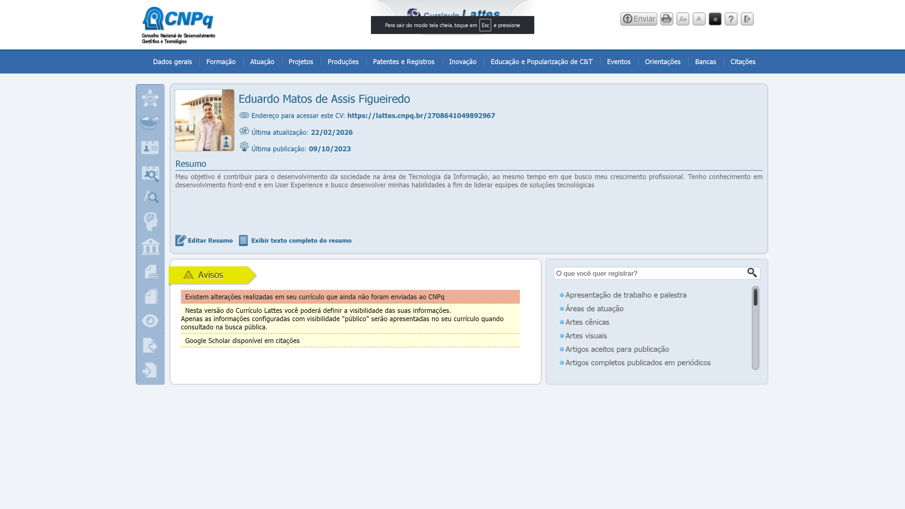

# Lattes

This folder holds context and field definitions for updating the user's Brazilian Lattes curriculum using existing data from LinkedIn, resume, and portfolio.

## Purpose

The contents here are intended to guide updates to the Lattes Curriculum (CNPq platform): platform overview, essential sections, strategic application for this profile, and structured documentation of specific Lattes form fields. The goal is to keep the Lattes profile aligned with the user's academic and professional trajectory and to support filling or refining sections from other sources.

## Contents

- **context.md** — Platform overview (CNPq Lattes), core purpose, essential sections (Personal Data and Summary, Education, Professional Experience, Areas of Expertise, Research Projects, Productions), and strategic application for this profile (e.g. Master's research on perceived trust in e-commerce, UX Researcher at Bosch, doctoral aims in machine learning or quantum computing). Includes the link to the user's Lattes curriculum: https://lattes.cnpq.br/2708641049892967

- **fields.md** — Single Lattes document: platform hierarchy, form field definitions (names, purpose, mapping), paste-ready content (status per field, future-fulfillment plan). **Open-text field values:** The specific text values for the two Lattes open-text fields (Texto inicial, Tradução) are in **fields.md** — in the "Content for Lattes" section (Dados gerais) and in the **highlighted copy-paste blocks** directly under the "Field 1 — Texto inicial" and "Field 2 — Tradução" tables. Use those blocks for quick copy-paste into the Lattes platform.

- **platform/lattes-platform.png** — Screenshot of the Lattes platform (Currículo Lattes profile page, Dados gerais tab). Use it as a visual reference for the main navigation (Dados gerais, Formação, Atuação, Projetos, Produções, etc.), the "Resumo" (Texto inicial) area, and the "O que você quer registrar?" quick-entry panel.

## Audience

Future AI assistants that help fill or refine Lattes sections should use this folder to understand the platform, the user's strategic focus, and how each documented field maps to context and to external data sources.
