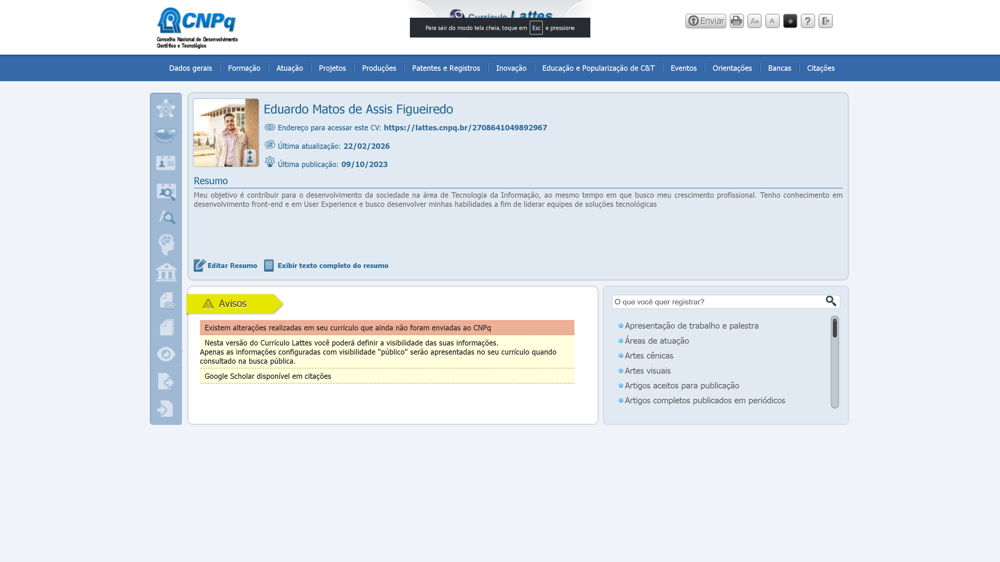

# Lattes form fields

Paste-ready content for the Lattes platform, by section. ✅ Fulfilled | ⏳ Partial | ⬜ Empty.



## Status legend

| Emoji | Meaning                   | Use when                                                                        |
| ----- | ------------------------- | ------------------------------------------------------------------------------- |
| ✅    | **Fulfilled**             | Data is available and can be pasted or slightly adapted for this Lattes field.  |
| ⏳    | **Partial / in progress** | Some data exists but the field is not complete (e.g. dissertation in progress). |
| ⬜    | **Empty (future)**        | No data yet; fulfillment depends on a future milestone.                         |

## Dados gerais

- **Identificação** ✅ — Nome: Eduardo Matos de Assis Figueiredo. E-mail: edu.evangelista.figueiredo@gmail.com. Telefone: +55 (19) 98176-6583. Endereço Lattes: https://lattes.cnpq.br/2708641049892967. LinkedIn: https://www.linkedin.com/in/eduardo-matos-de-assis-figueiredo-b10b408b
- **Endereço** ✅ — Nova Odessa, SP — Brasil.
- **Licença Maternidade, Paternidade e Adoção** ⬜ — N/A. Deixar em branco conforme o formulário. _(placeholder)_
- **Idiomas** ✅ — Português: língua materna (leitura, escrita, fala e compreensão plenos). Inglês: fluente (leitura, escrita, fala e compreensão em nível avançado).
- **Prêmios e títulos** ⬜ — Only academic prizes/titles belong here. _(placeholder: vazio até haver premiações acadêmicas.)_
- **Texto inicial do Currículo Lattes** ✅ — See section **Texto inicial (PT)** below.
- **Tradução (Texto inicial em inglês)** ✅ — See section **Tradução (EN)** below.
- **Outras informações relevantes** ✅ — Voluntário – ONG Hospitalhaços (atuação administrativa). Mestrado com conceito A em todas as disciplinas; proficiência em inglês comprovada.

## Formação

- **Formação acadêmica/titulação** ⏳ — Valores abaixo refletem exatamente o que foi cadastrado no Lattes para o Mestrado. Outros títulos (Tecnólogo, Técnico) em registros separados.

  **Mestrado (conforme Lattes — Dados Gerais / Detalhamento / Palavras-chave / Áreas / Setores):**

  | Campo                             | Valor                                                                                                                                                  |
  | --------------------------------- | ------------------------------------------------------------------------------------------------------------------------------------------------------ |
  | **Nível**                         | Mestrado                                                                                                                                               |
  | **Tipo de mestrado**              | normal                                                                                                                                                 |
  | **Instituição**                   | Universidade Estadual de Campinas                                                                                                                      |
  | **Curso**                         | TECNOLOGIA                                                                                                                                             |
  | **Status do curso**               | em andamento                                                                                                                                           |
  | **Período — Início (ano)**        | 2023                                                                                                                                                   |
  | **Período — Conclusão (ano)**     | (preencher no Lattes, ex.: 2026)                                                                                                                       |
  | **Obtenção do título (mês/ano)**  | —                                                                                                                                                      |
  | **Bolsa**                         | Sim / Não e Agência financiadora (conforme cadastrado)                                                                                                 |
  | **Título da dissertação/tese**    | Medindo a confiança percebida em websites: uma ferramenta digital apoiada por experimentação e aprendizado de máquina                                  |
  | **Nome completo do orientador**   | Regina Lúcia de Oliveira Moraes                                                                                                                        |
  | **Nome completo do coorientador** | —                                                                                                                                                      |
  | **Palavras-chave** (ordem)        | 1º acessibilidade; 2º Agentic AI; 3º usabilidade; 4º UX; 5º User Experience; 6º confiança em software                                                  |
  | **Áreas** (ordem)                 | 1º Ciência da Computação; 2º Sistemas de Informação; 3º Engenharia de Software                                                                         |
  | **Setores** (ordem)               | 1º Atividades dos serviços de tecnologia da informação; 2º Pesquisa e desenvolvimento científico; 3º Atividades de prestação de serviços de informação |
  | **Visibilidade**                  | Público ou Privado                                                                                                                                     |

  Outros títulos: Tecnólogo em Análise e Desenvolvimento de Sistemas (Unicamp, 2015–2020). Técnico em Informática (ETEC Bento Quirino, 2012–2014). Cada um em um registro próprio no Lattes.

  **Ajuda (Lattes):** Controle quem pode visualizar estas informações ao definir a visibilidade. **Público:** exibido na consulta pública. **Privado:** não exibido na consulta pública.

- **Pós-doutorado e/ou livre-docência** ⬜ — _(placeholder: Lorem ipsum — nenhum pós-doutorado; preencher quando houver.)_
- **Formação complementar** ✅ — Redação acadêmica, Pesquisa científica (da concepção à publicação), Inovação e transferência de tecnologia, Visualização de informações, Estudos dirigidos (Unicamp).

## Atuação

- **Atuação profissional** ✅ — Um registro por vínculo no Lattes. Use a tabela abaixo para preencher cada entrada (Instituição, Vínculo, Período, Outras informações, Visibilidade).

  **Campos do formulário Lattes (Atuação profissional):**

  | Campo no Lattes        | Descrição / valor de referência                                                                                                                                                                                                                                                                                                                                                                                                                                                                                                                                                                                                                                                                          |
  | ---------------------- | -------------------------------------------------------------------------------------------------------------------------------------------------------------------------------------------------------------------------------------------------------------------------------------------------------------------------------------------------------------------------------------------------------------------------------------------------------------------------------------------------------------------------------------------------------------------------------------------------------------------------------------------------------------------------------------------------------- |
  | **Instituição**        | Nome da Instituição (ex.: Robert Bosch Limitada; Bosch Magyarország).                                                                                                                                                                                                                                                                                                                                                                                                                                                                                                                                                                                                                                    |
  | **Vínculo**            | Tipo do vínculo (ex.: Possui vínculo empregatício); Enquadramento funcional (ex.: Analista de Pesquisa e Design, Desenvolvedor Web, Estagiário); Carga horária semanal; Dedicação exclusiva (Sim/Não).                                                                                                                                                                                                                                                                                                                                                                                                                                                                                                   |
  | **Período**            | Início: Mês e Ano; marcar **Atual (não finalizado)** ou **Anterior (finalizado)**.                                                                                                                                                                                                                                                                                                                                                                                                                                                                                                                                                                                                                       |
  | **Outras informações** | Texto livre (opcional). Por vínculo, use ou adapte: **(1) Mai/2023–presente (Bosch Brasil):** Liderança da região das Américas em maturidade de UX (Nível 4); integração de UX ao CIP (ServiceNow); portais de qualidade; projeto de tooling PT (requisitos a protótipos, check-ins com cliente); Power BI; Agentic AI; viagens à Alemanha (2024, 2025); tutor na SENAI Digital Talent Academy. **(2) Jan/2020–Nov/2023 (Bosch Brasil):** Desenvolvimento web, React, Scrum. **(3) Jan–Dez/2019 (Bosch Magyarország):** Suporte à digitalização da Business Excellence; ferramentas internas. **(4) Jan/2017–Nov/2018 (Bosch Brasil):** Estágio; VBA/Excel para melhoria contínua e comunicação interna. |
  | **Visibilidade**       | Público (exibido na consulta pública) ou Privado (não exibido).                                                                                                                                                                                                                                                                                                                                                                                                                                                                                                                                                                                                                                          |

  **Resumo por vínculo (para copiar/adaptar):** Bosch Brasil (mai/2023–presente): Analista de Pesquisa e Design; maturidade UX Nível 4, CIP/ServiceNow, tooling PT, Power BI, Agentic AI, Alemanha 2024/2025, tutor SENAI. Bosch Brasil (jan/2020–nov/2023): Desenvolvedor Web, React, Scrum. Bosch Magyarország (jan–dez/2019): Analista de Suporte à Digitalização. Bosch Brasil (jan/2017–nov/2018): Estagiário, VBA/Excel.

- **Linhas de pesquisa** ✅ — Confiança em software, interfaces e e-commerce; avaliação de UX, usabilidade e acessibilidade; Agentic AI para métricas de qualidade.
- **Membro de corpo editorial / comitê / Revisor de periódico / Revisor de projeto de fomento** ⬜ — _(placeholder: conteúdo a preencher quando houver.)_
- **Áreas de atuação** ✅ — Pesquisa em UX; Pesquisa aplicada; Tecnologia da Informação; IHC; Melhoria contínua (CIP); Sistemas de informação.

## Projetos

- **Projetos de pesquisa** ✅ — Pesquisa de mestrado (TrustMate, Agentic AI, confiança em sites/software). Integração de UX ao CIP (Bosch, ServiceNow, portais de qualidade).
- **Projeto de desenvolvimento tecnológico** ✅ — Tooling PT (requisitos a protótipos, check-ins cliente). Plataforma TrustMate (dissertação).
- **Projeto de extensão** ⏳ — Tutoria SENAI Digital Talent Academy.
- **Projeto de ensino / Outros** ⬜ — _(placeholder: a preencher quando houver.)_

## Produções

- **Produção Bibliográfica — Artigos em periódicos** ⬜ — Ainda não.
- **Artigos aceitos / Trabalhos em anais** ✅ — IHC 2025 (SBC SOL): "Interface Trustworthiness Score Definition Platform" (Regina Moraes, Andreia Casare). DOI: [10.5753/ihc_estendido.2025.12446](https://doi.org/10.5753/ihc_estendido.2025.12446). ISSRE 2025 (HFSD): "Measuring Perceived Trust in Websites…". DOI: [10.1109/ISSREW67781.2025.00069](https://doi.org/10.1109/ISSREW67781.2025.00069).
- **Apresentação de trabalho e palestra** ✅ — IHC 2025, ISSRE 2025.
- **Tradução (produção)** ✅ — Usar versão em inglês do Texto inicial (Dados gerais).
- **Produção Técnica — Relatório de pesquisa** ⏳ — Dissertação (TrustMate); concluir após defesa.
- **Programa de computador sem registro** ✅ — TrustMate; ferramentas CIP/UX (Power BI, ServiceNow).
- **Curso de curta duração ministrado** ✅ — SENAI Digital Talent Academy (tutor).
- **Desenvolvimento de material didático** ⏳ — Bootcamp Pesquisa Aplicada, materiais CIP–UX.
- **Redes sociais, websites e blogs** ✅ — LinkedIn: https://www.linkedin.com/in/eduardo-matos-de-assis-figueiredo-b10b408b
- **Patentes e Registros / Inovação** ⬜ — Nenhum.
- **Educação e Popularização de C&T** — Reutilizar participações em eventos, cursos SENAI, material, redes (conforme Produções/Eventos).
- **Eventos — Participação** ✅ — IHC 2025 (SBC), ISSRE 2025 (HFSD). **Organização** ⬜ — Preencher quando houver.
- **Orientações / Bancas** ⬜ — Nenhuma. Preencher quando houver orientandos ou convites para bancas.
- **Citações** ⬜ — Atualizar conforme citações (Google Scholar, Web of Science, SciELO, SCOPUS).

## Patentes e Registros

- _(placeholder: a preencher quando houver patentes ou registros.)_

## Inovação

- _(placeholder: a preencher quando houver dados de inovação.)_

## Educação e Popularização de C&T

- Reutilizar participações em eventos, cursos SENAI, material, redes (conforme Produções/Eventos). _(Itens vazios: placeholder a preencher quando houver.)_

## Eventos

- **Participação** ✅ — IHC 2025 (SBC), ISSRE 2025 (HFSD).
- **Organização** ⬜ — _(placeholder: a preencher quando houver.)_

## Orientações

- _(placeholder: Lorem ipsum — nenhuma orientação registrada; preencher quando houver orientandos.)_

## Bancas

- _(placeholder: a preencher quando convidado para bancas.)_

## Citações

- _(placeholder: atualizar conforme citações em Google Scholar, Web of Science, SciELO, SCOPUS.)_

---

## Future fulfillment plan

| Lattes field / section                           | Status | Trigger / milestone for fulfillment                                                     |
| ------------------------------------------------ | ------ | --------------------------------------------------------------------------------------- |
| Formação acadêmica — título e orientador         | ⏳     | Após defesa; confirmar no Lattes.                                                       |
| Artigos completos publicados em periódicos       | ⬜     | Quando workshop papers forem aceitos em periódico.                                      |
| Relatório de pesquisa (dissertação)              | ⏳     | Marcar concluído após defesa.                                                           |
| Orientações (concluídas / em andamento)          | ⬜     | Quando houver orientandos.                                                              |
| Bancas                                           | ⬜     | Quando convidado para bancas.                                                           |
| Citações                                         | ⬜     | À medida que os trabalhos forem citados.                                                |
| Patentes / Programa de Computador Registrado     | ⬜     | Se registrar software ou patente.                                                       |
| Pós-doutorado e/ou livre-docência                | ⬜     | Se cursar.                                                                              |
| Membro de corpo editorial / Revisor de periódico | ⬜     | Quando participar ou receber convites.                                                  |
| Organização de eventos                           | ⬜     | Quando coorganizar evento/sessão.                                                       |
| Prêmios e títulos                                | ⬜     | Only academic prizes; fill when you have one (e.g. thesis award, academic distinction). |

---

## Texto inicial (PT)

```
Pesquisador em Experiência do Usuário (UX) e desenvolvedor front-end, mestrando em Tecnologia pela Unicamp (previsão de conclusão em 2026). Foco na interseção entre inovação corporativa e rigor acadêmico. Pesquisa de mestrado em confiança percebida em e-commerce e em avaliação de usabilidade, acessibilidade e UX em software, com uso de Agentic AI e métodos científicos. Experiência como Analista de Pesquisa e Design na Bosch Brasil: liderança da região das Américas em maturidade de UX (Nível 4), integração de UX ao CIP, portais de qualidade e projetos internacionais. Objetivos acadêmicos: doutorado em aprendizado de máquina ou computação quântica e colaborações internacionais.
```

---

## Tradução (EN)

```
UX Researcher and Front-end Developer; Master's student in Technology (Unicamp, expected 2026). Specialized in integrating User Experience into organizational processes (CIP) and measuring software trustworthiness. Led regions to high UX maturity (Level 4), developed AI-driven quality gates, and managed international projects. Background in full-stack development and continuous improvement.
```
