# Portfolio deck – Mermaid diagrams

Open this file in an editor or viewer that supports Mermaid (e.g. VS Code with Mermaid preview, GitHub, or [Mermaid Live](https://mermaid.live)) to see all diagrams. Use a second screen to view diagrams while presenting the deck.

---

## 1. Why story flow (Slide 1)

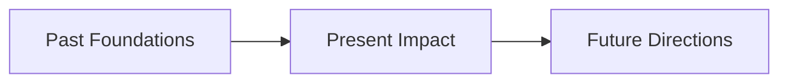

---

## 2. Academic timeline (Slide 3)

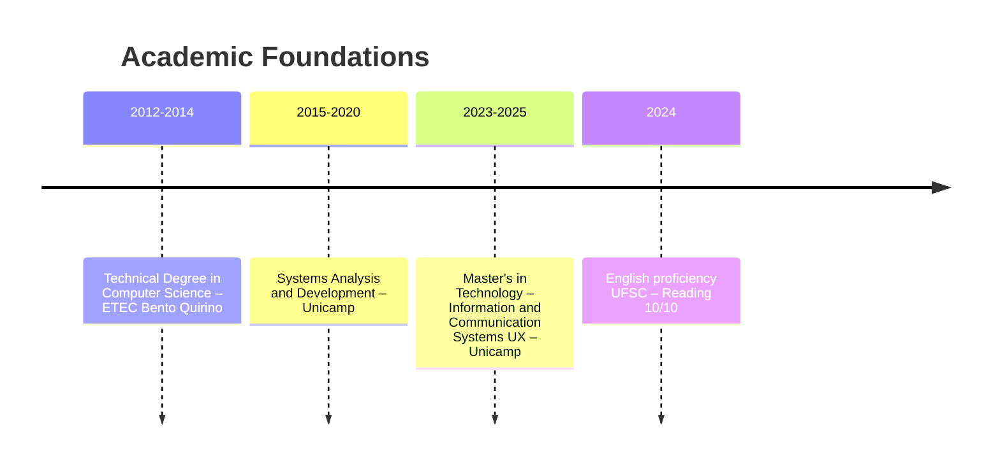

---

## 3. CIP-UX methodology pipeline (Slide 6)

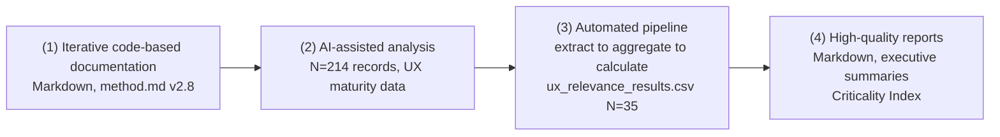

---

## 4. Academic research flow (Slide 8)

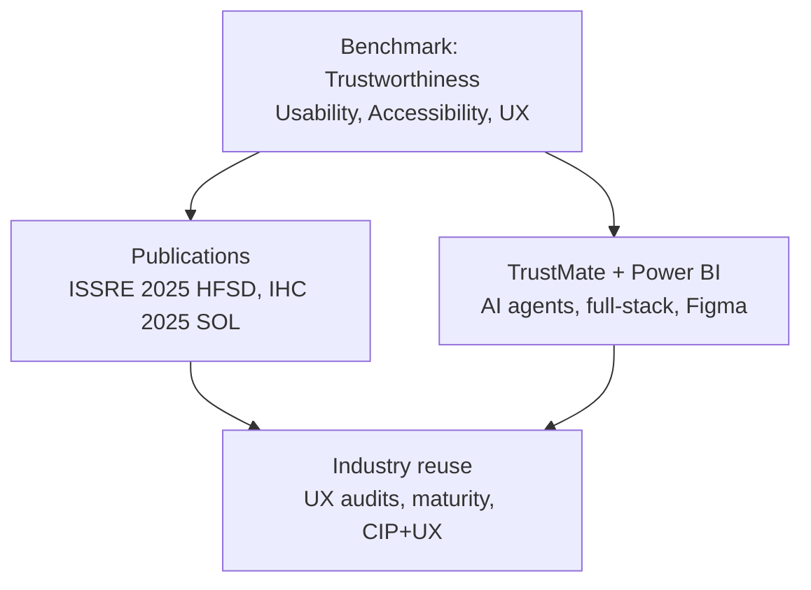

---

## 5. CSI and NPS performance (Slide 10)

```mermaid
block-beta
    columns 3
    "Project" "CSI" "NPS"
    "GS_R2S_TET2-LA UI Design Financial Portal" "5" "-"
    "EXT_PS_CCC Telemetry light vehicles" "5" "10"
    "EXT_M-PUR36 Tooling Management" "5" "10"
    "EXT_M-PMQ PPAP Application" "5" "10"
    "GS_P2P_MovDiv_Improvement part 1" "5" "10"
    "GS_P2P_Financial_Portal" "5" "10"
    "GS_UX Bootcamp 2024 Joinville 95 people" "4.9" "9.6"
    "GS_B2R_AA CF Automation" "4" "10"
    "Averages" "4.86" "9.94"
```

---

## 6. Dissertation database architecture (Slide 14)

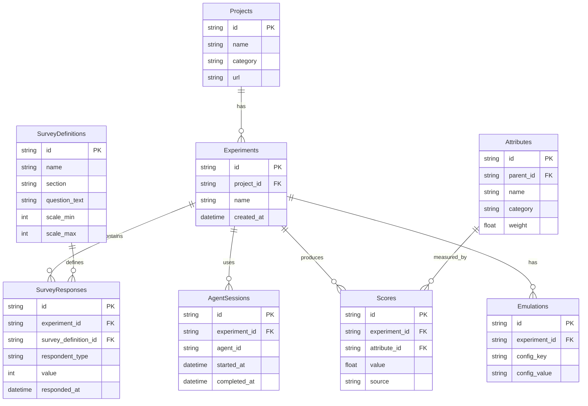

---

## 7. Dissertation tech pillars (Slide 14, optional)

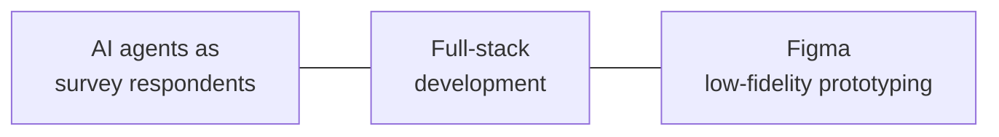

---

## 8. InfoVis PNAD visual structures (Slide 13)

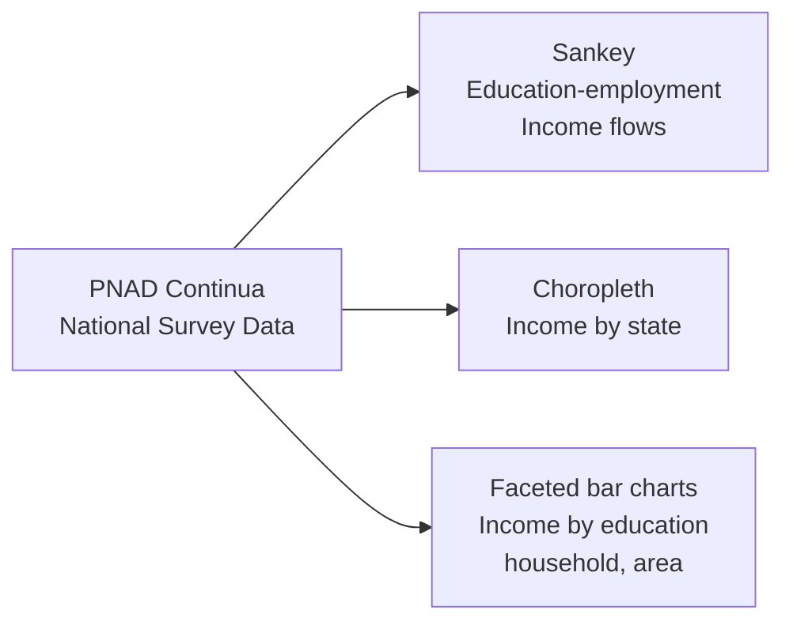

---

## 9. Tooling PT delivery workflow (Slide 16)

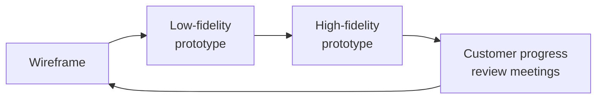

---

## 10. Proposal Generator UX phases (Slide 17)

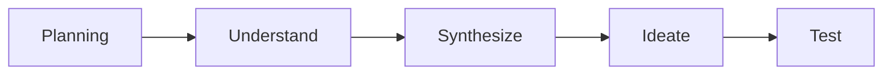

---

## 11. AI and Agile in Research (Slide 19)

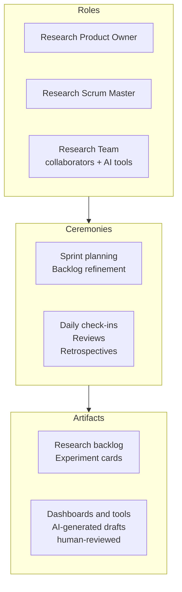

---

## 12. Experience timeline (Slide 21)

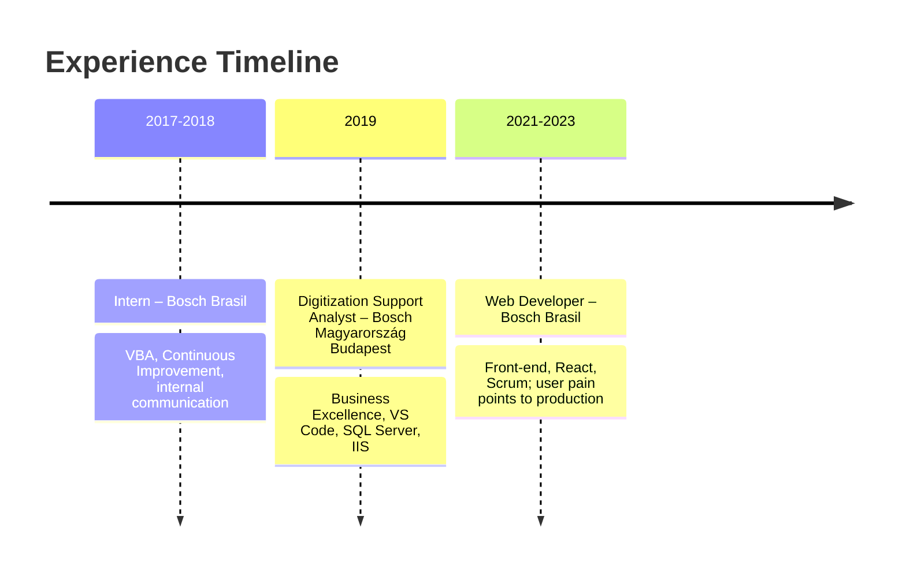

---

## 13. Future career path (Slide 22)

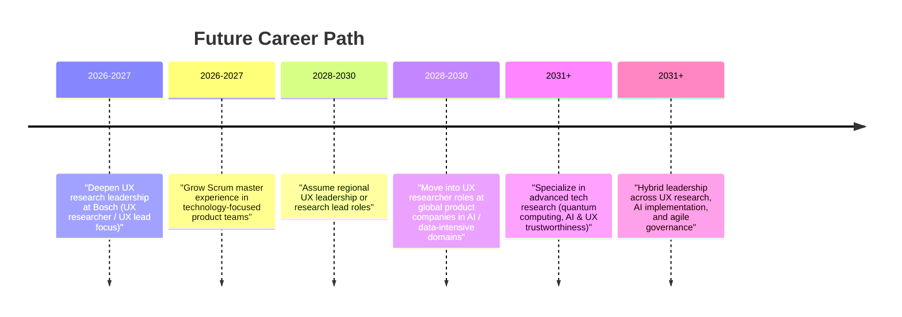

---

## 14. Future career – strategic views (Slide 22)

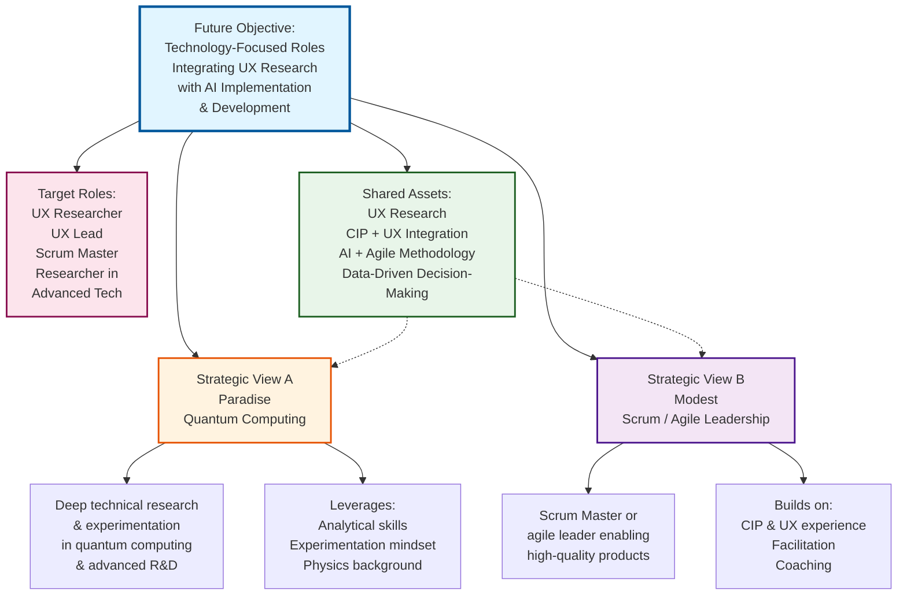
