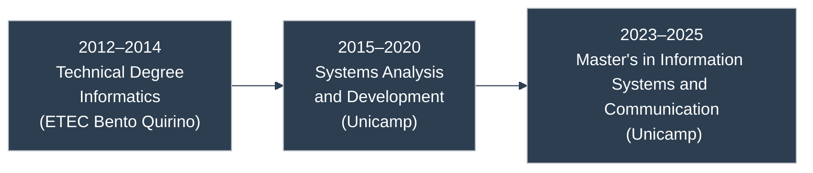
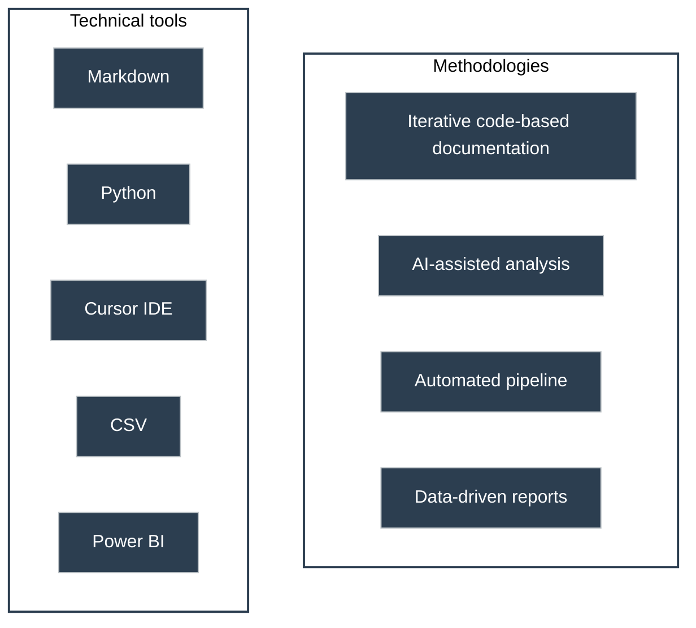
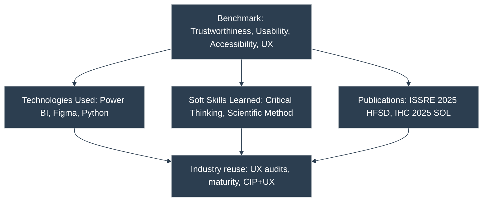
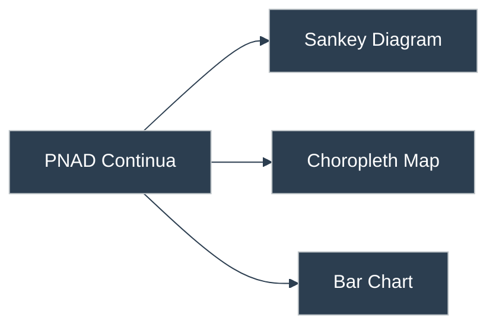
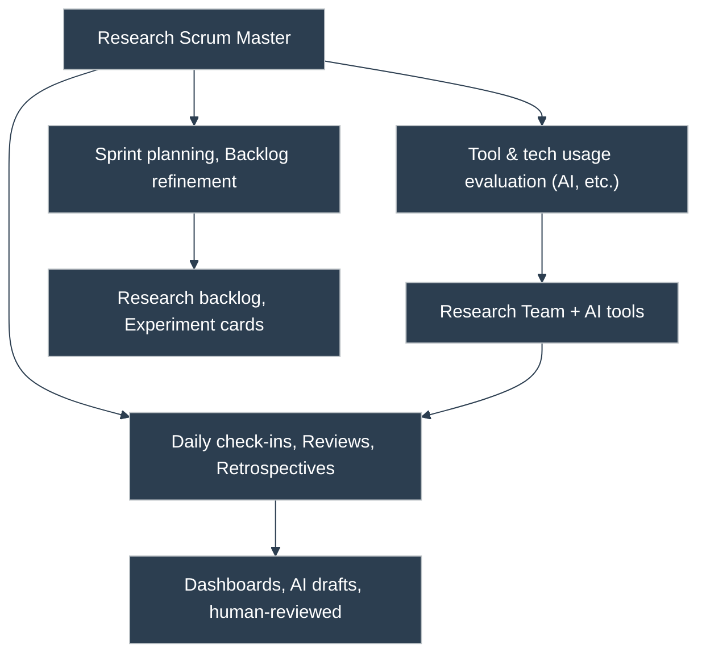
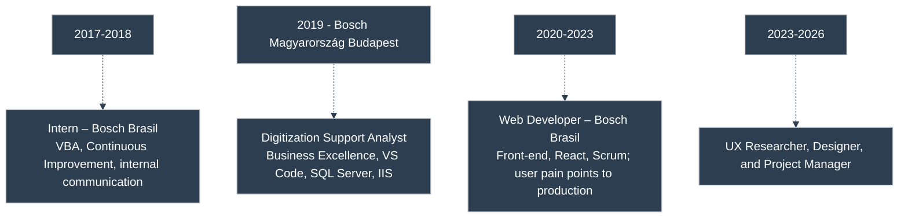
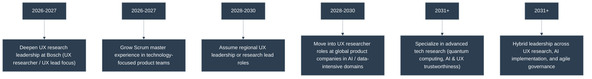
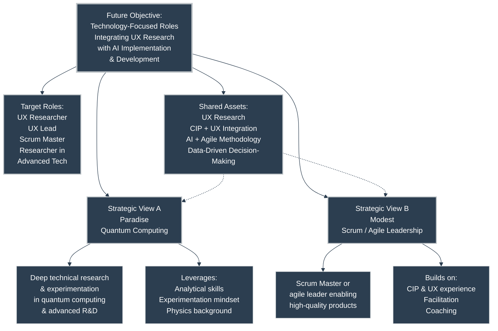

# Portfolio deck – Mermaid diagrams

Open this file in an editor or viewer that supports Mermaid (e.g. VS Code with Mermaid preview, GitHub, or [Mermaid Live](https://mermaid.live)) to see all diagrams. Use a second screen to view diagrams while presenting the deck.

## Diagram ID reference (file-naming safe)

| ID | Title | Deck slide(s) |
|----|-------|----------------|
| `story-flow` | Why story flow | 1 |
| `academic-timeline` | Academic timeline | 3 |
| `cip-ux-pipeline` | CIP-UX methodology pipeline | 6 |
| `academic-research-flow` | Academic research flow | 4 |
| `dissertation-tech` | Dissertation & research – technologies | 6 & 7 |
| `infovis-pnad-structures` | InfoVis PNAD visual structures | 8 |
| `tooling-pt-workflow` | Tooling PT delivery workflow | 9 |
| `proposal-generator-phases` | Proposal Generator UX phases | 10 |
| `ai-agile-research` | AI and Agile in Research | 11 |
| `experience-timeline` | Experience timeline | 12 |
| `future-career-path` | Future career path | 13 |
| `future-career-strategic-views` | Future career – strategic views | 14 |

**File naming:** Use the ID for sources and exports (e.g. `story-flow.mmd`, `story-flow.png`). All deck references use these IDs.

---

## 1. [story-flow] Why story flow (Slide 1)

---

## 2. [academic-timeline] Academic timeline (Slide 3)

---

## 3. [cip-ux-pipeline] CIP-UX methodology pipeline (Slide 6)

---

## 4. [academic-research-flow] Academic research flow (Slide 4)

---

## 5. [dissertation-tech] Dissertation & research – technologies (Slides 6 & 7)

---

## 6. [infovis-pnad-structures] InfoVis PNAD visual structures (Slide 8)

---

## 7. [tooling-pt-workflow] Tooling PT delivery workflow (Slide 9)

---

## 8. [proposal-generator-phases] Proposal Generator UX phases (Slide 10)

---

## 9. [ai-agile-research] AI and Agile in Research (Slide 11)

*Narrative for slide:* The **Research Scrum Master** facilitates the process (sprint planning, backlog refinement, daily check-ins, reviews, retrospectives) and evaluates whether the team is using tools and tech correctly (e.g. AI, AR). The research team works with AI tools and participates in ceremonies; outcomes include research backlog, experiment cards, dashboards, and human-reviewed AI drafts.

---

## 10. [experience-timeline] Experience timeline (Slide 12)

---

## 11. [future-career-path] Future career path (Slide 13)

---

## 12. [future-career-strategic-views] Future career – strategic views (Slide 14)

