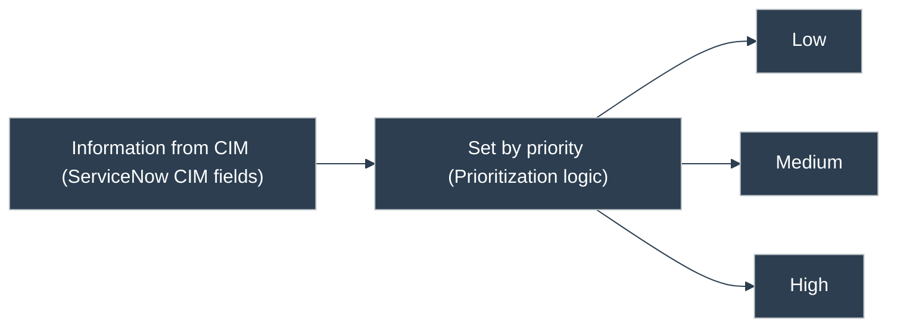
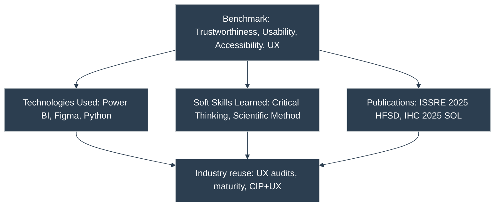
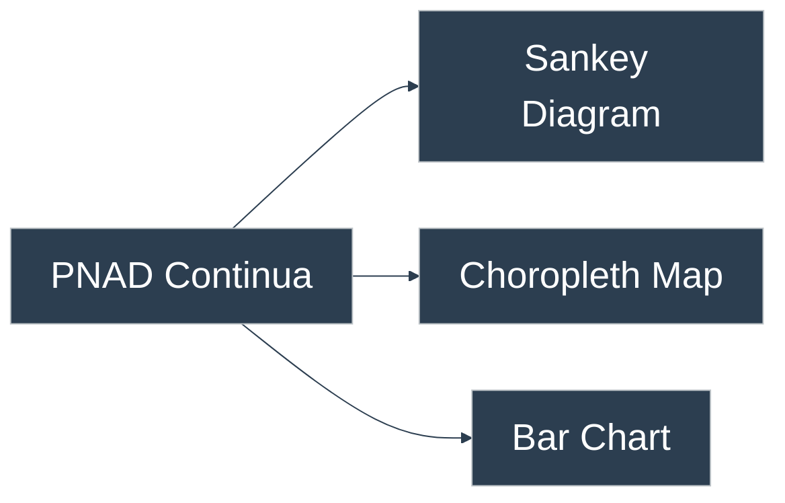
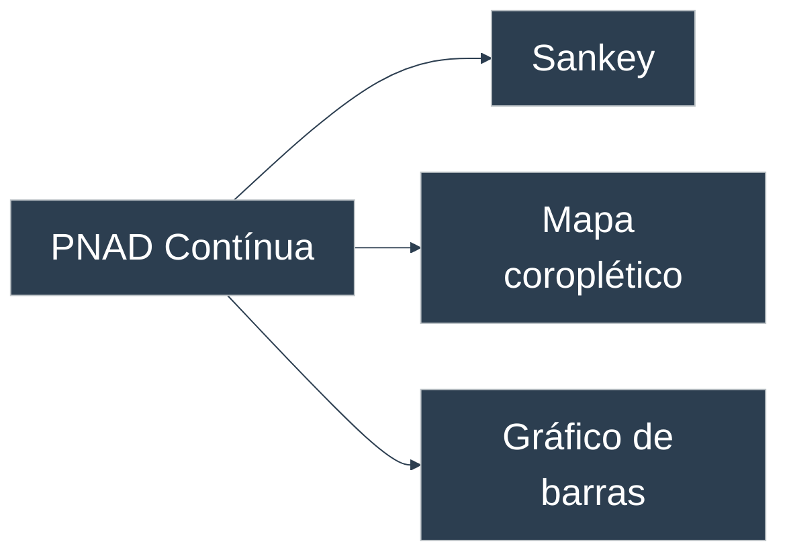
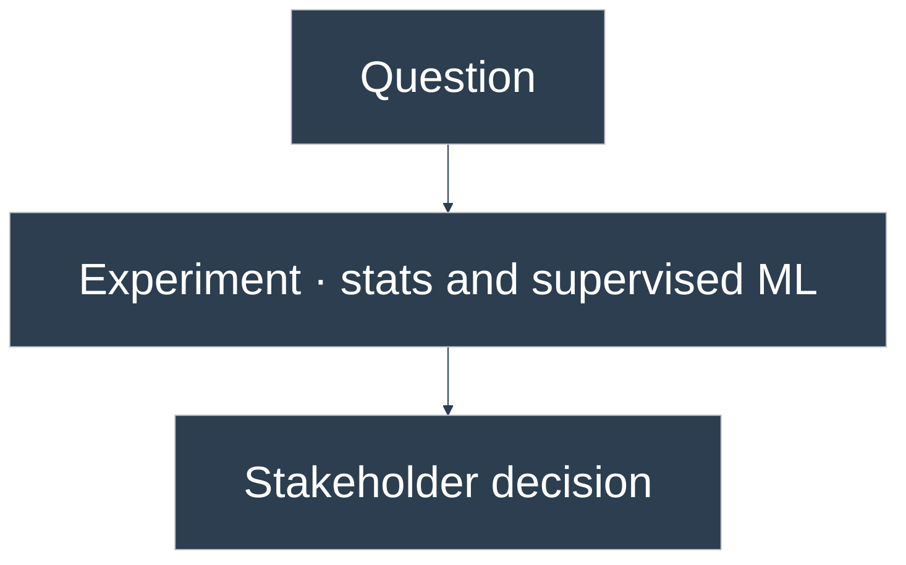
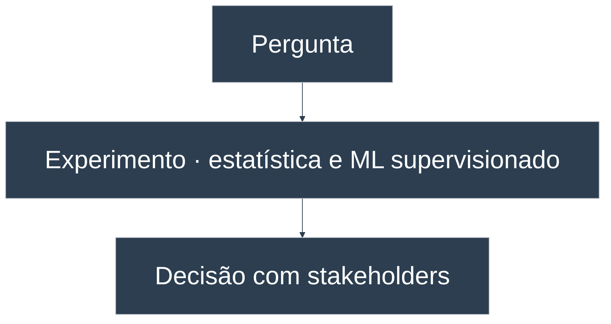
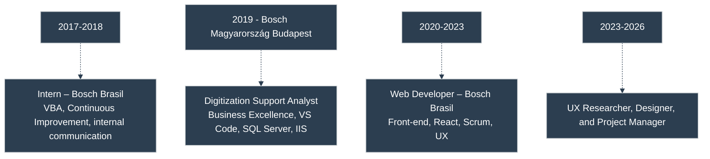
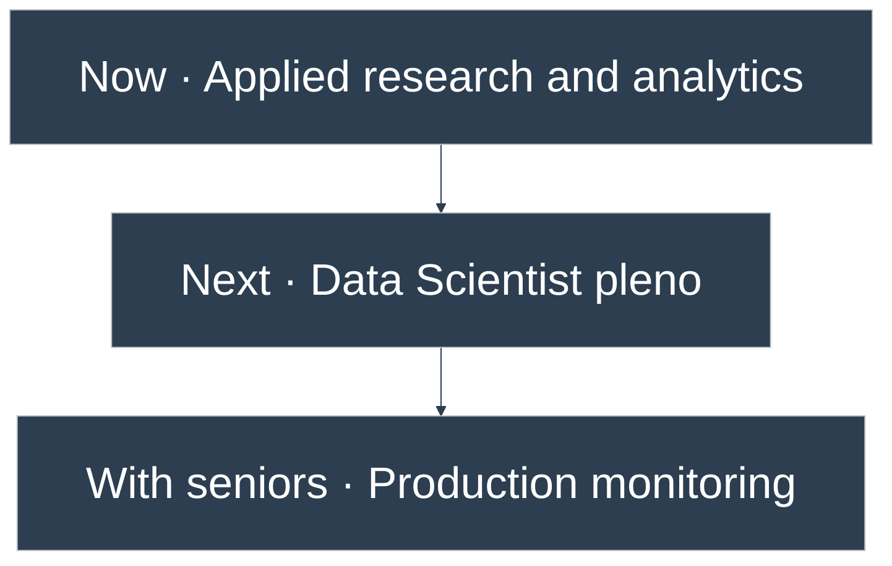
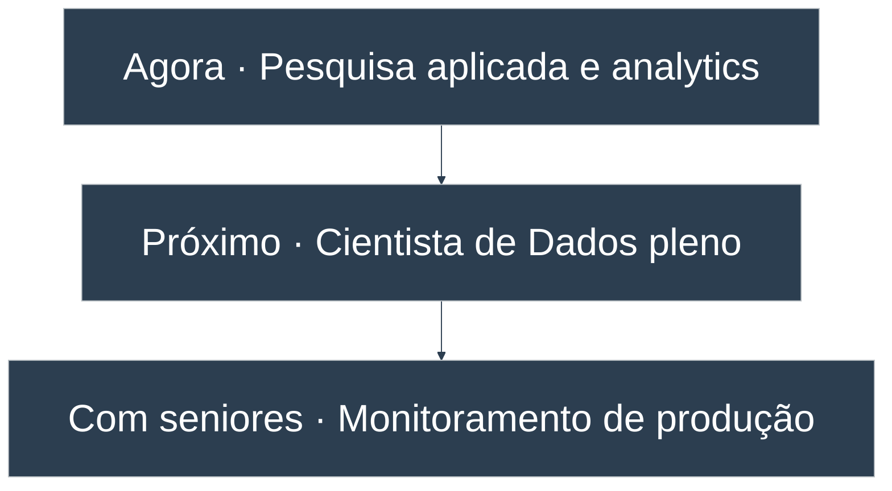

# Portfolio deck – Mermaid diagrams

Open this file in an editor or viewer that supports Mermaid (e.g. VS Code with Mermaid preview, GitHub, or [Mermaid Live](https://mermaid.live)) to see all diagrams. Use a second screen to view diagrams while presenting the deck.

## Diagram ID reference (file-naming safe)

| ID                          | Title                                      | Deck slide(s) |
| --------------------------- | ------------------------------------------ | ------------- |
| `story-flow`                | Why story flow                             | 1             |
| `academic-timeline`         | Academic timeline                          | 3             |
| `cip-ux-pipeline`           | CIP-UX methodology pipeline                | 6             |
| `ux-relevance-model`        | UX relevance evaluation model              | 6a            |
| `academic-research-flow`    | Academic research flow                     | 4             |
| `dissertation-tech`         | Dissertation & research – technologies     | 6 & 7         |
| `infovis-pnad-structures`   | InfoVis PNAD visual structures             | 8             |
| `tooling-pt-workflow`       | Tooling PT delivery workflow               | 9             |
| `proposal-generator-phases` | Proposal Generator UX phases               | 10            |
| `ai-agile-research`         | Question, experiment, stakeholder decision | 11            |
| `experience-timeline`       | Experience timeline                        | 12            |
| `future-career-path`        | Path to Data Scientist pleno               | 13            |

**File naming:** Use the ID for sources and exports (e.g. `story-flow.mmd`, `story-flow.png`). All deck references use these IDs.

---

## 1. [story-flow] Why story flow (Slide 1)

---

## 2. [academic-timeline] Academic timeline (Slide 3)

---

## 3. [cip-ux-pipeline] CIP-UX methodology pipeline (Slide 6)

```mermaid
%%{init: {'theme': 'base', 'themeVariables': { 'primaryColor': '#2c3e50', 'primaryTextColor': '#fff', 'primaryBorderColor': '#bdc3c7', 'lineColor': '#2c3e50', 'fontFamily': 'Lato', 'subgraphBg': '#ffffff', 'subgraphBorder': '#2c3e50', 'subgraphTextColor': '#000000', 'subgraphTitleColor': '#000000'}}}%%
flowchart TB
  subgraph methodologies [Methodologies]
    M1["Iterative code-based documentation"]
    M2["AI-assisted analysis"]
    M3["Automated pipeline"]
    M4["Data-driven reports"]
  end
  subgraph tools [" "]
    direction LR
    subgraph tools_col1 [" "]
      direction TB
      T1["Markdown"]
      T2["Python"]
      T3["Cursor IDE"]
      T4["CSV"]
      T5["Power BI"]
    end
    subgraph tools_col2 [" "]
      direction TB
      T6["Mermaid diagrams"]
      T7["Matplotlib"]
      T8["Seaborn"]
      T9["HTML"]
      T10["CSS"]
    end
  end
  style methodologies fill:#ffffff,stroke:#2c3e50,stroke-width:2px,color:#000000
  style tools fill:transparent,stroke:none
  style tools_col1 fill:transparent,stroke:none
  style tools_col2 fill:transparent,stroke:none
  style T1 fill:#2c3e50,stroke:none
  style T2 fill:#2c3e50,stroke:none
  style T3 fill:#2c3e50,stroke:none
  style T4 fill:#2c3e50,stroke:none
  style T5 fill:#2c3e50,stroke:none
  style T6 fill:#2c3e50,stroke:none
  style T7 fill:#2c3e50,stroke:none
  style T8 fill:#2c3e50,stroke:none
  style T9 fill:#2c3e50,stroke:none
  style T10 fill:#2c3e50,stroke:none
```

---

## 3b. [ux-relevance-model] UX relevance evaluation model (Slide 6a)

---

## 4. [academic-research-flow] Academic research flow (Slide 4)

---

## 5. [dissertation-tech] Dissertation & research – technologies (Slides 6 & 7)

---

## 6. [infovis-pnad-structures] InfoVis PNAD visual structures (Slide 8)

English export: `infovis-pnad-structures-en.png`.

Portuguese export: `infovis-pnad-structures-pt.png`.

---

## 7. [tooling-pt-workflow] Tooling PT delivery workflow (Slide 9)

---

## 8. [proposal-generator-phases] Proposal Generator UX phases (Slide 10)

---

## 9. [ai-agile-research] Question, experiment, stakeholder decision (Slide 11)

_Narrative for slide:_ The path toward Data Scientist pleno is a working loop: start from a question, run an experiment with statistics and supervised ML, and leave stakeholders with a decision they can use.

English export: `ai-agile-research-en.png`.

Portuguese export: `ai-agile-research-pt.png`.

---

## 10. [experience-timeline] Experience timeline (Slide 12)

---

## 11. [future-career-path] Path to Data Scientist pleno (Slide 13)

English export: `future-career-path-en.png`.

Portuguese export: `future-career-path-pt.png`.

