<!-- _class: lead -->

<!--
  HOW TO CALIBRATE IMAGES (Marp/PDF): Every slide with images has a 

# Why I Work in Technology, Project Management & Research
## Trustworthy, human-centered software for complex services

- I believe that software used in service organizations must be **trustworthy, usable, and inclusive**, especially when decisions affect people and businesses at scale.
- My work centers **technology**, **project management**, and **in-depth research**, integrating evidence and user needs into processes via systematic delivery.
- This portfolio tells that story:

<!-- Diagram: story-flow (mermaid/diagrams.md). Export to story-flow.png -->

---

<!-- Slide 2 – Who I Am (Golden Circle: Who/What) -->

<!-- _class: midnight-blue-slide photo-at-bottom -->

## Who I Am – Snapshot

| Attribute | Value |
| --------- | ----- |
| Name | Eduardo M. de A. Figueiredo |
| Role | Research, Technology & Project Management |
| Impact | Clearer governance and faster improvement flow; builds scalable research maturity and evidence-based prioritization; uses research to support solid product and service decisions; delivers with data, accountability, and measurable results. |
| Contact | Nova Odessa, SP – Brazil · edu.evangelista.figueiredo@gmail.com · LinkedIn / +55 19 98176-658 |

  
<!-- 
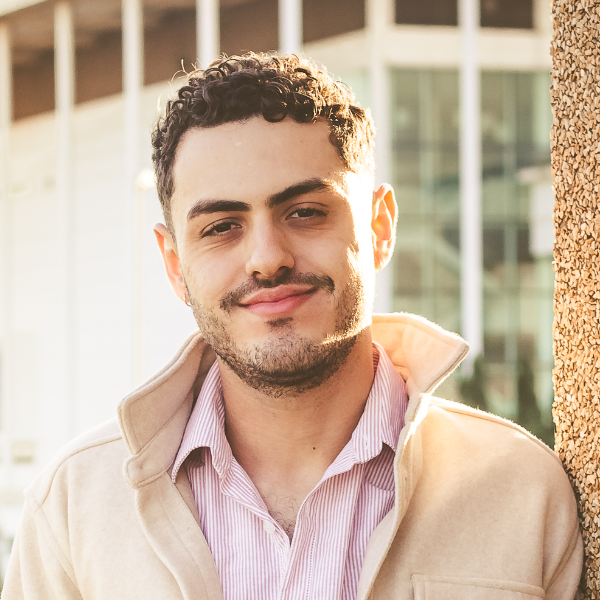
 -->

---

<!-- Slide 3 – Past (Foundations: Education & Profile) -->

<!-- _class: art-top-right -->

## Past – Academic Foundations & Professional Profile

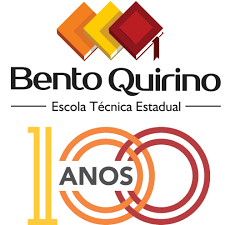

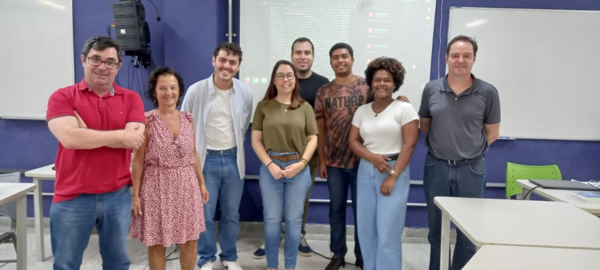

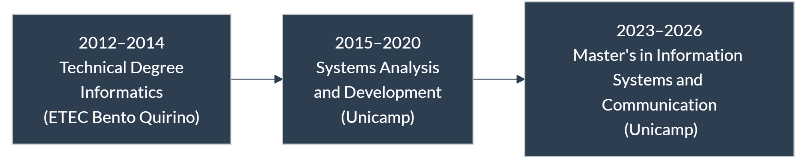

I feel proactive, self-reliant and organized.

<strong>Grade 'A' in all Master's coursework</strong>; English proficiency test verification.

<!-- Diagram: academic-timeline (mermaid/diagrams.md). Export to academic-timeline.png -->  

---

<!-- Slide 5 – Present (Role & Strategic Impact) -->

<!-- _class: art-top-right -->

## Present – Research & Technology (Bosch Brasil)

| Area | Achievement |
| ---- | ----------- |
| Role | Research & Technology – Bosch Brasil (May 2023 – present); Research Project Champion GS/BDU |
| International | Two trips to Germany (2024, 2025) for role-related work |
| CO2 Tracking (GS/Research) | Marketing scouting for CO2 telemetry; finding: lack of market demand |
| Research Maturity | Led Americas to Level 4 – governance, templates, training |
| CIP + Research | Led integration into ServiceNow CIM; research gate in CIP workflow |
| Collaboration | Tutor at SENAI Digital Talent Academy |  

---

<!-- Slide 6 – Present (CIP and Research Integration: Critical Career Milestone) -->

<!-- _class: art-top-right -->

## Present – CIP and Research Integration: A Critical Career Milestone

- **Career significance:** This project marks a pivotal evolution into **Senior Researcher** capabilities—combining in-depth, data-oriented investigation with technical execution, project management, and governance.  
- **Project scope:** Integrated **research relevance assessment** into the **Continuous Improvement Process (CIP)** in ServiceNow CIM. A **research gate** sits between Assess and Approve; the method runs at that gate to triage improvement initiatives (Low / Medium / High research relevance).  
- **Methodology—developer skills for research:** Utilized **Cursor IDE**, **AI-assisted coding**, and version-controlled Python pipelines. Workflow:

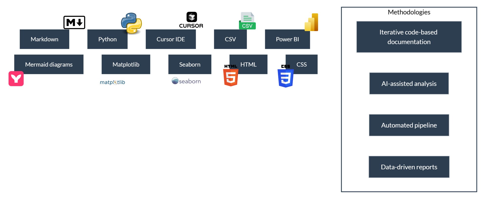

- **Deliverables:**

| Deliverable | Description |
| ----------- | ----------- |
| Research Relevance Quick Method | 10 system-calculated questions from 11 CIM fields; thresholds Low &lt;60, Medium 60–70, High ≥70 |
| 1st Research Report (Jan 2026) | Stakeholder inputs, governance clarity |
| Pipeline | extract_cim_data.py, calculate_relevance_scores.py, aggregate_to_csv.py – reproducible validation |

- **Impact:** Governance clarity, reduced perceived delay, and reusable research governance framework. Aligned CAP and research into a unified, defensible solution.

<!-- Diagram: CIP-Research pipeline (mermaid/diagrams.md). Export to cip-ux-pipeline.png -->  

---

<!-- Slide 6b – Present (CIP and Research Integration: Research Artifacts & Visuals) -->

<!-- _class: dense-content cip-research-images -->

## Present – CIP and Research Integration: Research Artifacts & Visuals

- **High-quality, data-oriented deliverables** produced using Markdown, Python pipelines, and Cursor IDE: (1) **1st Research Report** (January 2026)—"Make governance clear. Keep improvements moving."—consolidating N=214 records, executive summary, literature benchmark, methodology, findings, and strategic opportunities; (2) **Research Relevance Quick Method** (method.md v2.8)—CIM-to-Q1–Q10 mapping, scoring algorithm, post-evaluation workflow; (3) **Pipeline** (`tests/standalone-tests/pipeline/`)—extraction, aggregation, score calculation, validation. Distribution (N=35): Low 57.1%, Medium 20.0%, High 22.9%.

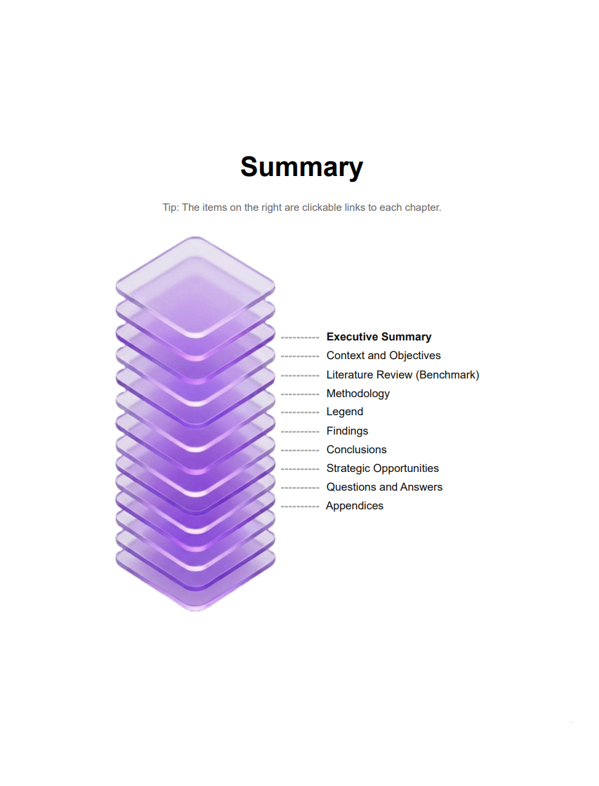

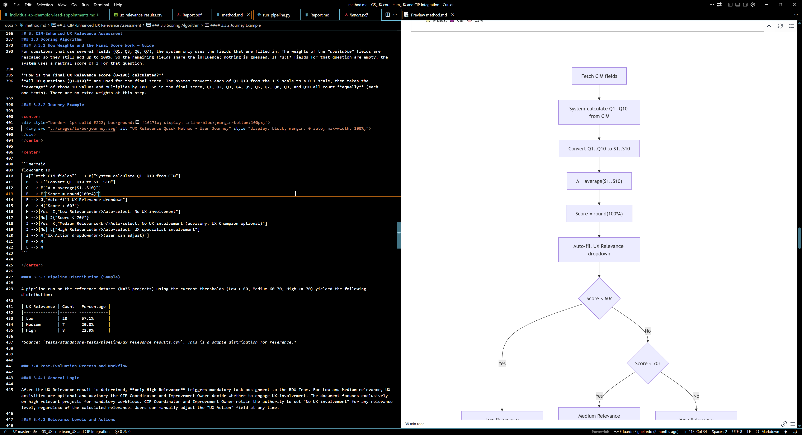

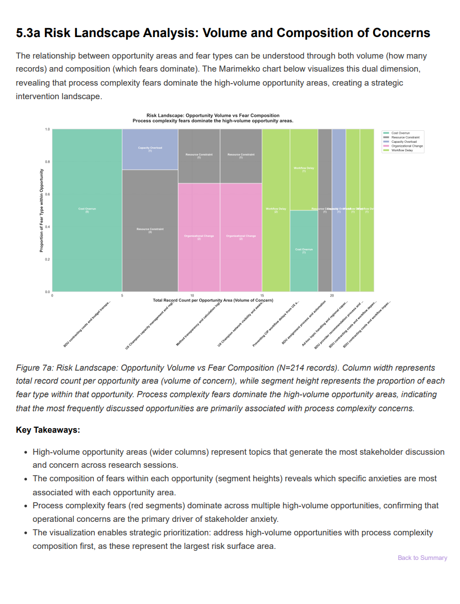

---

<!-- Slide 8 – Present (Academic Research & TrustMate) -->

<!-- _class: art-top-right -->

## Present – Academic Research (Trust in AI & UI)

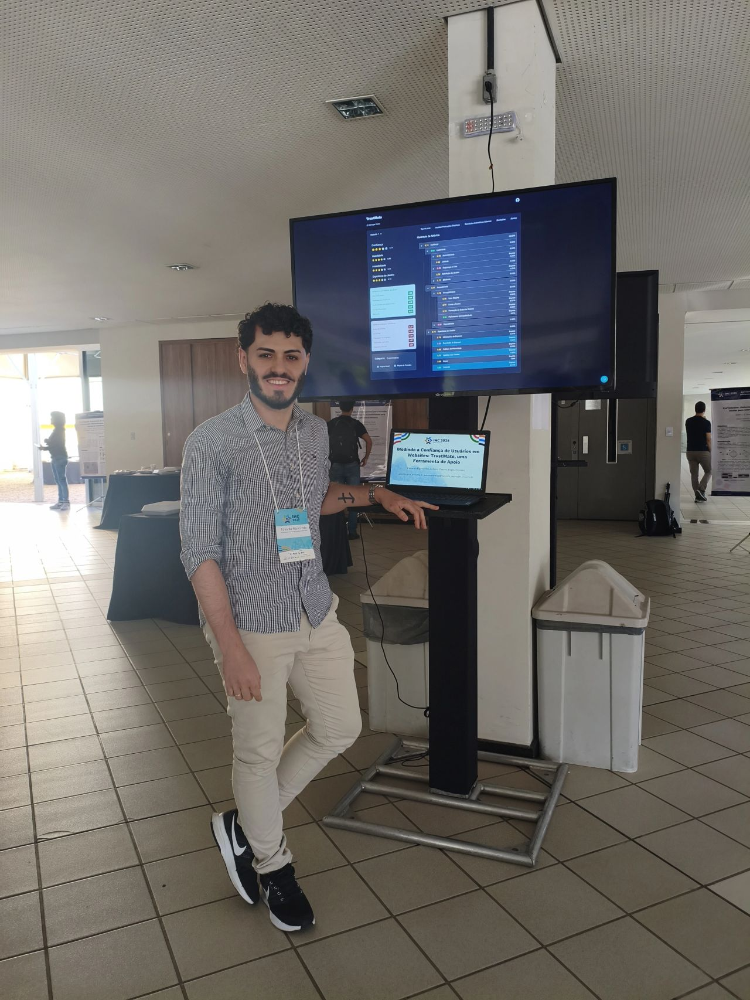

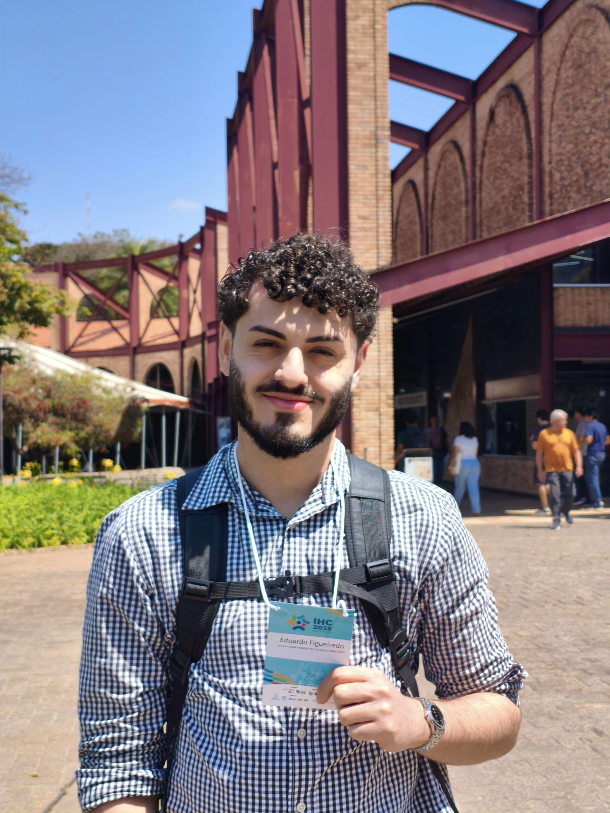

- **Master's focus:** Benchmark to assess software trustworthiness (usability, accessibility, user-centred research). Thesis: quantitative methods for perceived trust in e-commerce and software interfaces.  
- **Publications:** ISSRE 2025 (HFSD – IEEE), IHC 2025 (SBC SOL). **TrustMate** + Power BI for trust scores; **AI agents as survey respondents**, full-stack development, Figma prototyping.  
- **Industry connection:** Methods and tools reusable for research audits, maturity assessments, and CIP + research work.

<!-- Diagram: academic-research-flow (mermaid/diagrams.md). Export to academic-research-flow.png -->  

---

<!-- Slide 9 – Present (Scientific Publications – Snapshot) -->

<!-- _class: dense-content article-images -->

## Present – Scientific Publications (Visual Evidence)

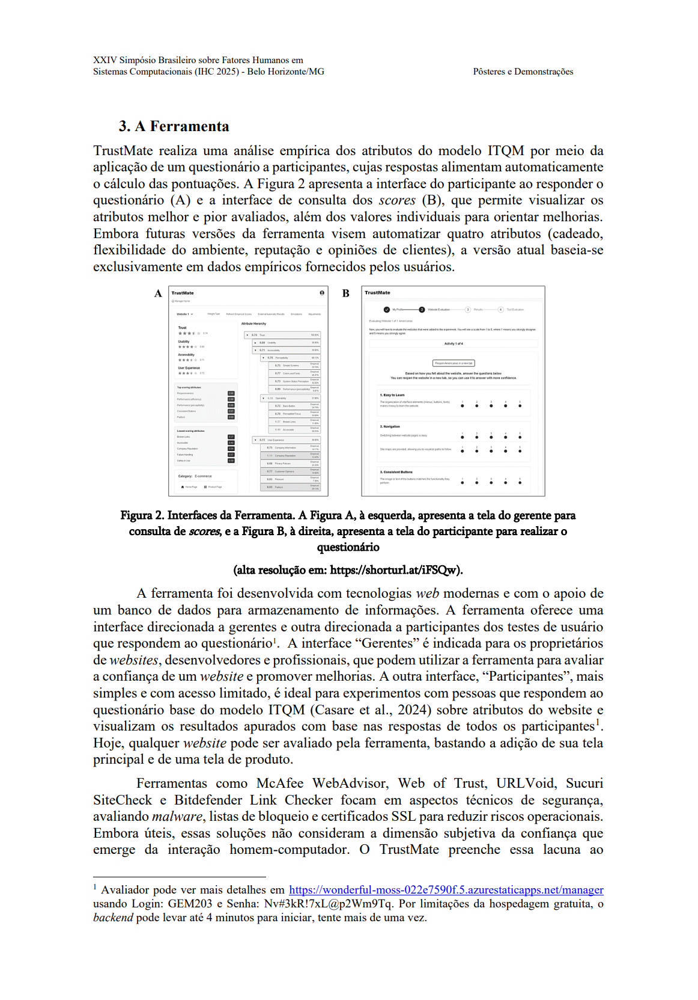

- Published work in **ISSRE 2025 (HFSD Workshop)** and **IHC 2025 (SBC SOL)**; master's dissertation on software trustworthiness.

---

<!-- Slide 10 – Present (CSI & NPS Performance 2024–2025) -->

## Present – CSI & NPS Performance (2024–2025)

- **High customer satisfaction** across eight research-led projects delivered in 2024–2025. **Averages: CSI 4.86 / 5, NPS 9.94 / 10.**

| Project | CSI | NPS |
| ------- | --- | --- |
| GS_R2S Financial Portal | 5 | — |
| EXT_PS_CCC Telemetry | 5 | 10 |
| EXT_M-PUR36 Tooling | 5 | 10 |
| EXT_M-PMQ PPAP | 5 | 10 |
| GS_P2P_MovDiv | 5 | 10 |
| GS_P2P_Financial_Portal | 5 | 10 |
| GS Research Bootcamp 2024 | 4.9 | 9.6 |
| GS_B2R_AA CF Automation | 4 | 10 |
| **Averages** | **4.86** | **9.94** |

---

<!-- Slide 11 – Present (Power BI Dashboards at Work) -->

<!-- _class: dense-content work-pbi-images -->

## Theme: Data Visualization – Power BI Dashboards at Work

- **Bosch Research Americas (GS):** Power BI dashboards developed in role for project and resource oversight and for training tracking—supporting data-driven decision-making and governance.

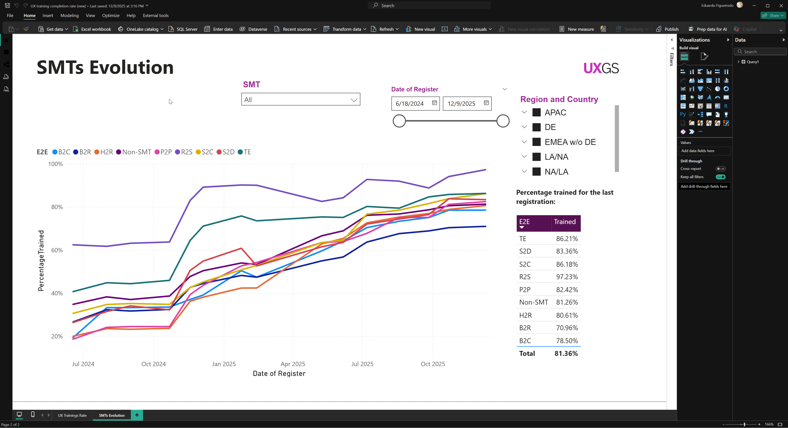

---

<!-- Slide 12 – Present (Dissertation: Power BI Visualizations) -->

<!-- _class: dense-content dissertation-pbi-images -->

## Theme: Data Visualization – Dissertation Power BI

- **Dissertation InfoVis (Power BI):** Dashboards and charts for trust-metrics analysis—variability of human scores across websites (Americanas, MadeiraMadeira, Kabum), AI × human homogeneity by attribute, and line comparisons (human vs AI scores per website). Supports validation of trust perception models and consolidation of research findings.

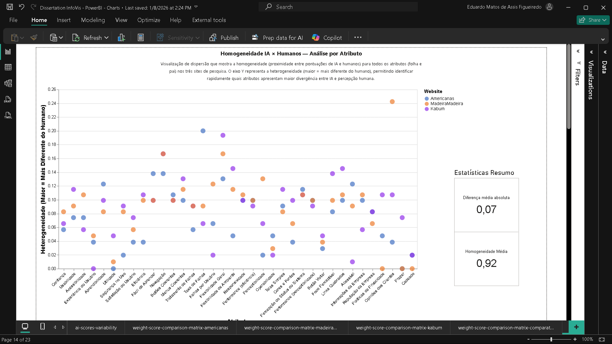

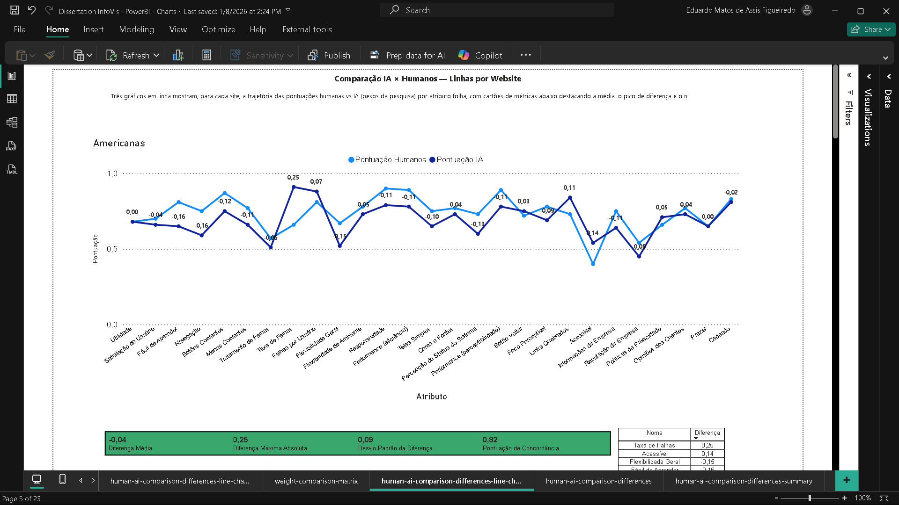

---

<!-- Slide 13 – Present (InfoVis Project – Power BI & PNAD Contínua) -->

<!-- _class: dense-content infovis-pbi-images -->

## Theme: Data Visualization – InfoVis Project (PNAD Contínua)

- **InfoVis class project – Power BI:** Built multi-page reports using **PNAD Contínua** (Brazil's National Household Sample Survey). Brazil’s National Household Sample Survey.

- **Impact:** Demonstrates **Power BI** proficiency and **processing complex national research datasets** into clear, actionable visual insights for socioeconomic analysis.

<!-- Diagram: infovis-pnad-structures (mermaid/diagrams.md). Export to infovis-pnad-structures.png -->

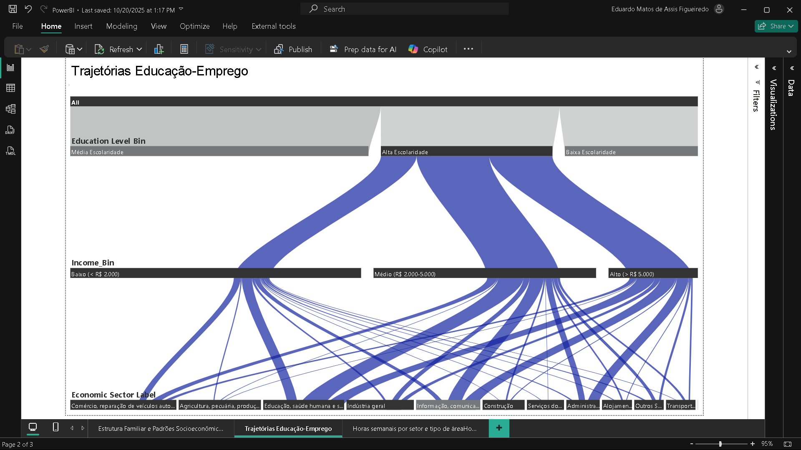

---

<!-- Slide 14 – Present (Dissertation: Technical Implementation & Impact) -->

## Theme: Technical Implementation – Dissertation (AI & Full Stack)

- **Architecture:** Database design supporting projects, experiments, attributes, scores, and agent runs.

<!-- Diagram: dissertation-tech (mermaid/diagrams.md). Export to dissertation-tech.png -->

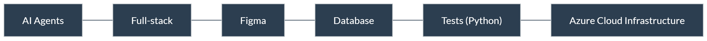

---

<!-- Slide 15 – Present (Dissertation: Technical Visuals) -->

<!-- _class: dense-content dissertation-tech-images -->

## Theme: Technical Implementation – Visual Evidence

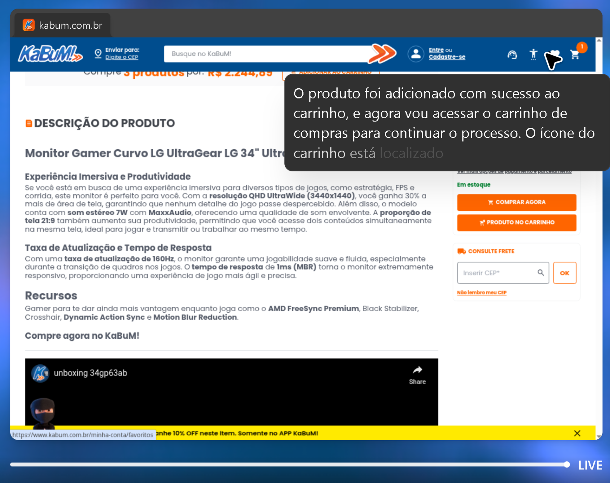

---

<!-- Slide 16 – Present (Tooling Project for PT) -->

<!-- _class: dense-content tooling-project-images -->

## Theme: Technical Implementation – Tooling Project for PT

- **Tooling project for PT:** Key development in **technical delivery and project management**—from requirements to high-fidelity deliverable, with **customer progress review meetings** throughout.

<!-- Diagram: tooling-pt-workflow (mermaid/diagrams.md). Export to tooling-pt-workflow.png -->

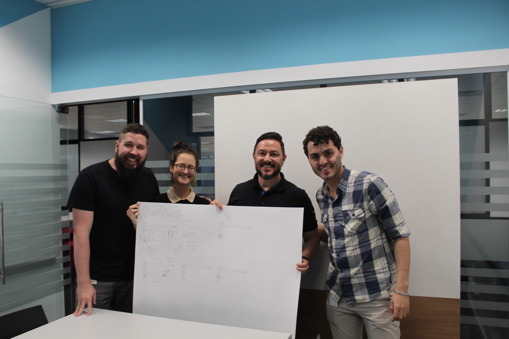

---

<!-- Slide 17 – Present (Proposal Generator – Excel VBA) -->

<!-- _class: art-top-right -->

## Theme: Technical Implementation – Proposal Generator (Excel VBA)

- **Definition:** Excel-based application for **automated proposal creation**—project proposals: define activities, estimate hours, Gantt-style timeline, and generate PowerPoint.
- **Generation logic:** Uses **predefined criteria and historical project data**; outputs (activities, hours, timeline) are driven by that logic.

- **Technical proficiency:** Developed in **Excel VBA**—macros for automation, calculations, and presentation generation.

<!-- Diagram: proposal-generator-phases (mermaid/diagrams.md). Export to proposal-generator-phases.png -->

---

<!-- Slide 18 – Present (InfoVis Project – PhraseNets Web Visualization) -->

<!-- _class: dense-content phrase-net-images -->

## Theme: Technical Implementation – PhraseNets Web Visualization

- **Course project – Information Visualization (InfoVis):** Developed a web-based PhraseNets visualization to explore relationships in text.\
- **Technique:** Implements PhraseNets pattern-based networks (e.g. subject–verb, verb–object) to reveal co-occurrence structures that standard charts miss.\
- **Why it matters:** Demonstrates proficiency in **web development** (interactive browser-based interface) and **advanced visual structures** beyond standard Power BI capabilities.

---

<!-- Slide 19 – Future (AI & Agile in Research) -->
<!-- Diagram: ai-agile-research (mermaid/diagrams.md). Export to ai-agile-research.png -->

## Theme: Process & Future – AI & Agile in Research

- **Motivation:** Research projects often lack repeatable, quality-focused processes and clear accountability.  
- **Proposal:** Combine **AI assistance** with **Scrum practices** to improve throughput, transparency, and quality.  
- **Approach:**

- **Guardrails:** AI outputs treated as drafts; strong focus on reproducibility, data privacy, and explicit quality criteria.  

---

<!-- Slide 20 – Present (Innovation & Awards) -->

<!-- _class: art-top-right compact-list -->

## Theme: Process & Innovation – Awards

| Award | Place | Year / Context |
| ----- | ----- | -------------- |
| X-Games Brazil | 1st | 2018 – New Business Creation / Consultancy |
| Bosch Talent Forum | 3rd | 2018 – Project Management Software |
| Bosch Intern Talent Forum | 3rd | 2018 – Intern projects |
| NGO Hospitalhaços | Volunteer | Admin – social impact and community engagement |  

---

<!-- Slide 21 – Past (Experience Timeline) -->

<!-- _class: art-top-right dense-content -->

## Theme: Process – Experience Timeline (Condensed)

- **Trajectory across Bosch locations:** Brazil, Hungary (Budapest), Germany, Argentina.

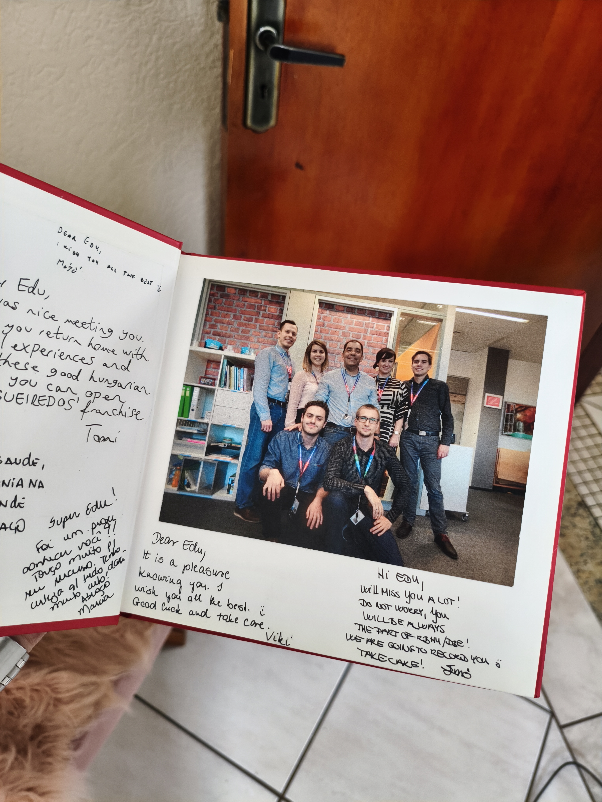

<!-- Diagram: experience-timeline (mermaid/diagrams.md). Export to experience-timeline.png -->  

---

<!-- Slide 22 – Future (Career Aspirations, Vacancy Types & Prioritized Paths to Leadership) -->

## Future – Career Aspirations, Vacancy Types & Prioritized Paths to Leadership

<!-- Diagram: future-career-path (mermaid/diagrams.md). Export to future-career-path.png -->

- **Prioritized career paths (all leading to a Lead position):** (1) **Priority 1 – Ideal:** PhD within Bosch supporting the company with Quantum or AI technology; (2) **Priority 2:** Research Scrum Master who also provides technical support; (3) **Priority 3:** Deep Researcher.
- **Future objective:** Work in **technology-focused roles** that integrate **in-depth research, project management, and AI implementation** as a core professional interest.
- **Desired vacancy types (Bosch & external):**

| Type | Bosch examples | External examples |
| ---- | -------------- | ----------------- |
| Researcher / Senior | Global Service Solutions – service platforms, internal tools | Trust & Safety – trust, safety, fairness at scale |
| Technology / PM Lead | Digital / Enterprise Applications – B2B tools for service teams | — |
| Scrum Master / Agile Coach | — | Data-informed, research-oriented facilitation |
| Researcher advanced tech | — | Quantum & AI – technology and human factors |  
- **Target roles:** Researcher, Technology / Project Management Lead, Scrum Master, or Researcher in advanced tech contexts.
- **Scrum Master role – focus:** Data-informed, research-oriented agile facilitation for technology, AI, and trustworthiness projects; project management and delivery quality. Core responsibilities: **data integrity** and **statistical relevance** across experiments; **rigorous application of scientific methods** and **adequate use of AI** (never replacing human judgment); managing timelines to prevent stagnation. Proactive unblocking (e.g. short surveys, mandatory 10-minute sessions); **direct customer contact** and **stakeholder accountability** for deliverables.
- **Shared assets across paths:** Research, CIP + research integration, AI + agile methodology, data-driven decision-making.

---

<!-- Slide 23 – Future (Personal Interests as Career Enablers) -->

<!-- _class: dense-content personal-images -->

## Future – Personal Interests that Power My Work

- **At home:** Two cats, beginner piano practice, and a split keyboard for macro creation and productivity.

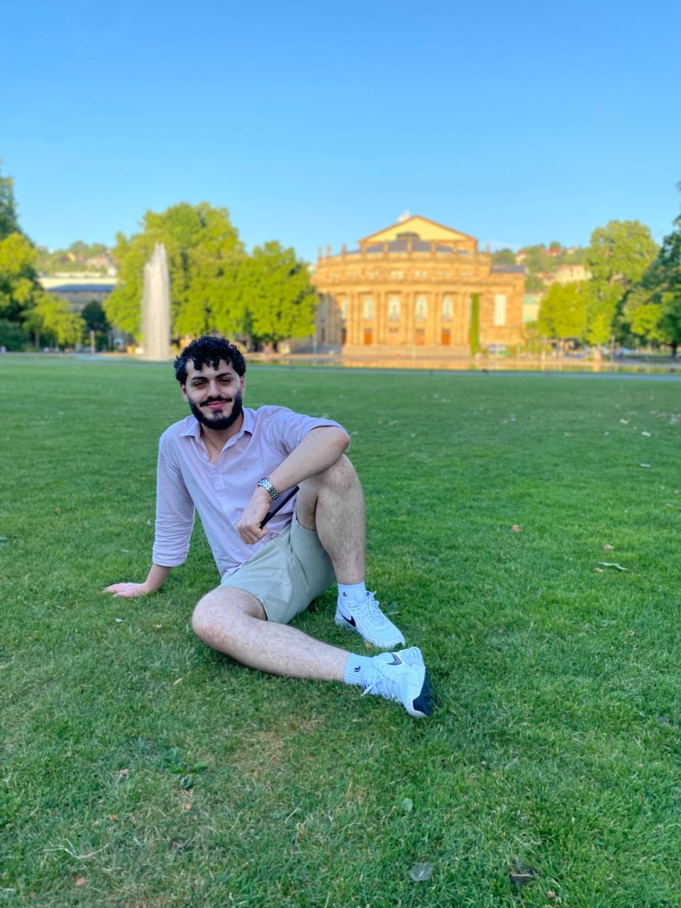

| Interest | Career enabler |
| -------- | -------------- |
| Piano | Discipline, structured practice, performance under pressure |
| Linguistics (phonology & phonetics) | Clarity in copy; speech interfaces and accessibility |
| Physics (GR & Quantum) | Complex systems; quantum computing and advanced tech research |
| Acting | Empathy, storytelling, presence in interviews and workshops |
| Impressionist art | Nuanced perception and diverse perspectives in research |
| Macro creation | Automation and workflow optimization |
| Specialized keyboards | Ergonomics, productivity, technology and accessibility |  

---

<!-- Slide 26 – Closing & Contact -->

<!-- _class: midnight-blue-slide -->

## Closing & Contact

**What I bring**

| Area | Summary |
| ---- | ------- |
| Core | In-depth Research, Technology & Project Management |
| Leadership | Research Maturity Level 4 – Americas |
| Milestone | CIP and Research Integration – Cursor IDE, AI, coding; Senior Researcher evolution |
| Research | Trust in interfaces; data-driven decision-making |

**Let's connect:** Email: edu.evangelista.figueiredo@gmail.com · LinkedIn: https://www.linkedin.com/in/eduardo-figueiredo · Resume PDF and this portfolio deck available on request.

---

<!-- Slide 27 – Blank Conclusion Page -->

<!-- _class: blank-midnight-blue -->

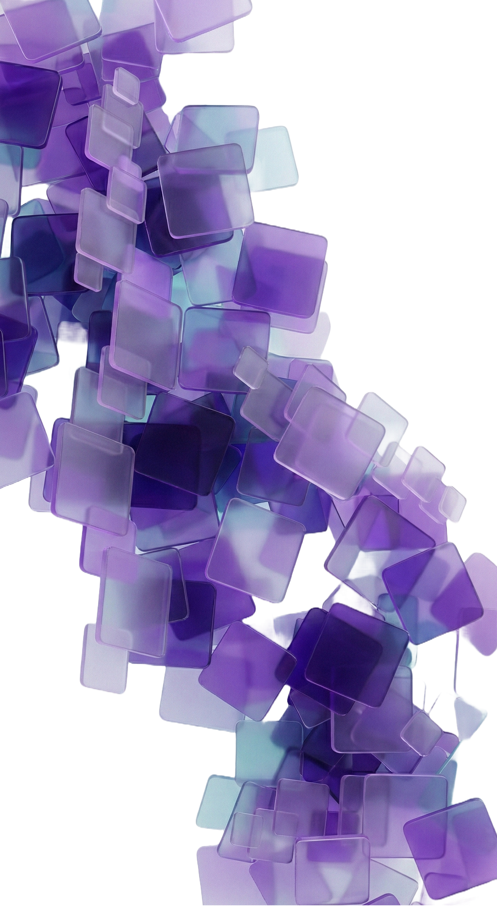
