<!-- _class: lead -->

<!-- Slide 1 – Why (Golden Circle: Why) -->

# Why I Work in Technology, Project Management & Research
## Trustworthy, human-centered software for complex services

- I believe that software used in service organizations must be **trustworthy, usable, and inclusive**—especially when decisions affect people and businesses at scale.
- My work centers **technology**, **project management**, and **in-depth research**—integrating evidence and user needs into processes via **Continuous Improvement (CIP)** and systematic delivery.
- This portfolio tells that story:

[INSERT DIAGRAM HERE: Why story flow]

<!-- Mermaid source: why-story-flow.mmd - render to why-story-flow.png
flowchart LR
  Past["Past Foundations"]
  Present["Present Impact"]
  Future["Future Directions"]
  Past --> Present --> Future
-->

---

<!-- Slide 2 – Who I Am (Golden Circle: Who/What) -->

<!-- _class: art-top-right midnight-blue-slide -->

## Who I Am – Snapshot

[INSERT TABLE HERE: Who I Am snapshot]

| Attribute | Value |
| --------- | ----- |
| Name | Eduardo M. de A. Figueiredo |
| Role | Research, Technology & Project Management (Master's, Unicamp) |
| Focus | Technology, CIP governance, in-depth research, and measuring software trustworthiness |
| Impact | Americas UX Maturity Level 4; AI-driven UX quality gates; international projects |
| Contact | Nova Odessa, SP – Brazil · edu.evangelista.figueiredo@gmail.com · LinkedIn / phone on request |  

---

<!-- Slide 3 – Past (Foundations: Education & Profile) -->

<!-- _class: art-top-right -->

## Past – Academic Foundations & Professional Profile

[INSERT DIAGRAM HERE: Academic timeline]

- **Master's thesis:** Benchmark to assess software trustworthiness via Usability, Accessibility, and UX. Grade 'A' in all Master's coursework (Unicamp transcript available on request).
- **Professional profile:** Proactive, self-reliant, organized; combines **in-depth research**, **technology**, and **project management** with agile practices (Scrum, Kanban) and delivery leadership.

<!-- Mermaid source: academic-timeline.mmd - render to academic-timeline.png
timeline
    title Academic Foundations
    2012-2014 : Technical Degree in Computer Science – ETEC Bento Quirino
    2015-2020 : Systems Analysis and Development – Unicamp
    2023-2025 : Master's in Technology – Information and Communication Systems UX – Unicamp
    2024 : English proficiency UFSC – Reading 10/10
-->  

---

<!-- Slide 5 – Present (Role & Strategic Impact) -->

<!-- _class: art-top-right -->

## Present – Research & Technology (Bosch Brasil)

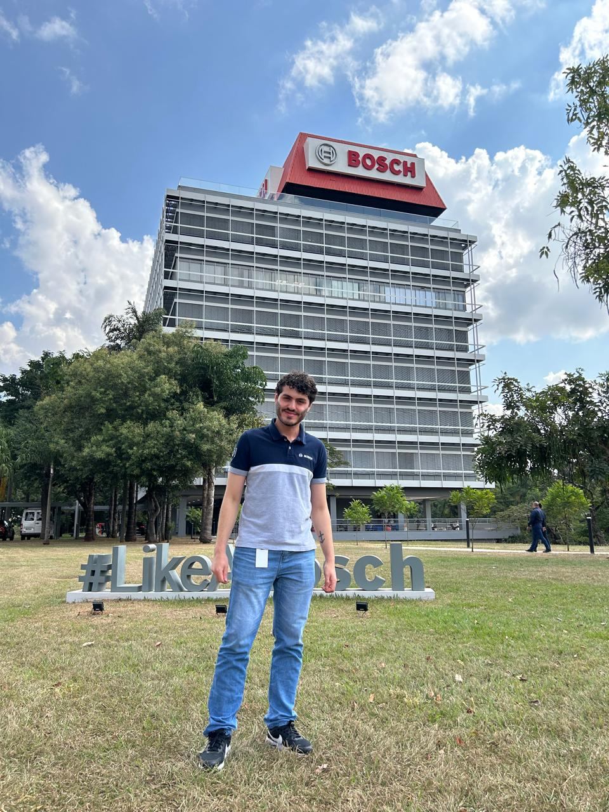

[INSERT TABLE HERE: Present role achievements]

| Area | Achievement |
| ---- | ----------- |
| Role | Research & Technology – Bosch Brasil (May 2023 – present); UX Project Champion GS/BDU |
| International | Two trips to Germany (2024, 2025) for role-related work |
| CO2 Tracking (GS/UX) | Marketing scouting for CO2 telemetry; finding: lack of market demand |
| UX Maturity | Led Americas to Level 4 – governance, templates, training |
| CIP + UX | Led integration into ServiceNow CIM; UX gate in CIP workflow |
| Collaboration | Tutor at SENAI Digital Talent Academy; scientific methods and project delivery |  

---

<!-- Slide 6 – Present (CIP and UX Integration: Critical Career Milestone) -->

<!-- _class: art-top-right -->

## Present – CIP and UX Integration: A Critical Career Milestone

- **Career significance:** This project marks a pivotal evolution into **Senior Researcher** capabilities—combining in-depth, data-oriented investigation with technical execution, project management, and governance.  
- **Project scope:** Integrated **UX relevance assessment** into the **Continuous Improvement Process (CIP)** in ServiceNow CIM. A **UX gate** sits between Assess and Approve; the method runs at that gate to triage improvement initiatives (Low / Medium / High UX relevance).  
- **Methodology—developer skills for research:** Utilized **Cursor IDE**, **AI-assisted coding**, and version-controlled Python pipelines. Workflow:

[INSERT DIAGRAM HERE: CIP-UX methodology pipeline]

- **Deliverables:**

[INSERT TABLE HERE: CIP-UX deliverables]

| Deliverable | Description |
| ----------- | ----------- |
| UX Relevance Quick Method | 10 system-calculated questions from 11 CIM fields; thresholds Low &lt;60, Medium 60–70, High ≥70 |
| 1st Research Report (Jan 2026) | Stakeholder inputs, governance clarity |
| Pipeline | extract_cim_data.py, calculate_ux_scores.py, aggregate_to_csv.py – reproducible validation |

- **Impact:** Governance clarity, reduced perceived delay, and reusable UX governance framework. Aligned CAP and UX into a unified, defensible solution.

<!-- Mermaid source: cip-ux-pipeline.mmd - render to cip-ux-pipeline.png
flowchart LR
  A["(1) Iterative code-based documentation\nMarkdown, method.md v2.8"]
  B["(2) AI-assisted analysis\nN=214 records, UX maturity data"]
  C["(3) Automated pipeline\nextract to aggregate to calculate\nux_relevance_results.csv N=35"]
  D["(4) High-quality reports\nMarkdown, executive summaries\nCriticality Index"]
  A --> B --> C --> D
-->  

---

<!-- Slide 6b – Present (CIP and UX Integration: Research Artifacts & Visuals) -->

<!-- _class: dense-content cip-ux-images -->

## Present – CIP and UX Integration: Research Artifacts & Visuals

- **High-quality, data-oriented deliverables** produced using Markdown, Python pipelines, and Cursor IDE: (1) **1st Research Report** (January 2026)—"Make governance clear. Keep improvements moving."—consolidating N=214 records, executive summary, literature benchmark, methodology, findings, and strategic opportunities; (2) **UX Relevance Quick Method** (method.md v2.8)—CIM-to-Q1–Q10 mapping, scoring algorithm, post-evaluation workflow; (3) **Pipeline** (`tests/standalone-tests/pipeline/`)—extraction, aggregation, score calculation, validation. Distribution (N=35): Low 57.1%, Medium 20.0%, High 22.9%.

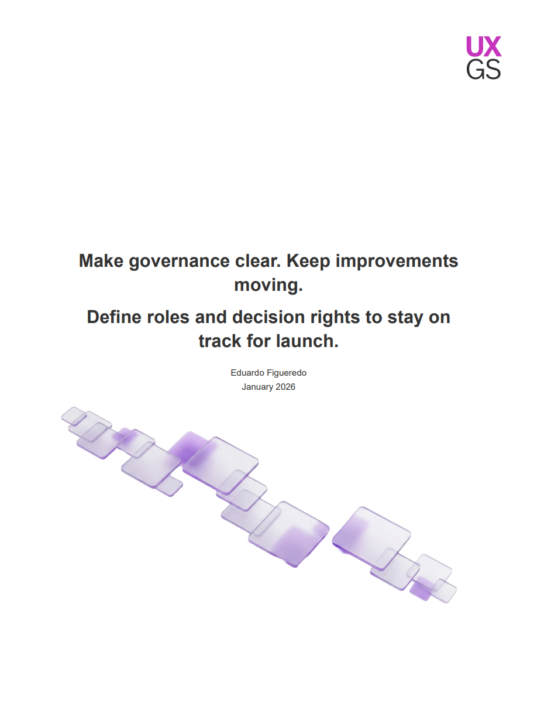

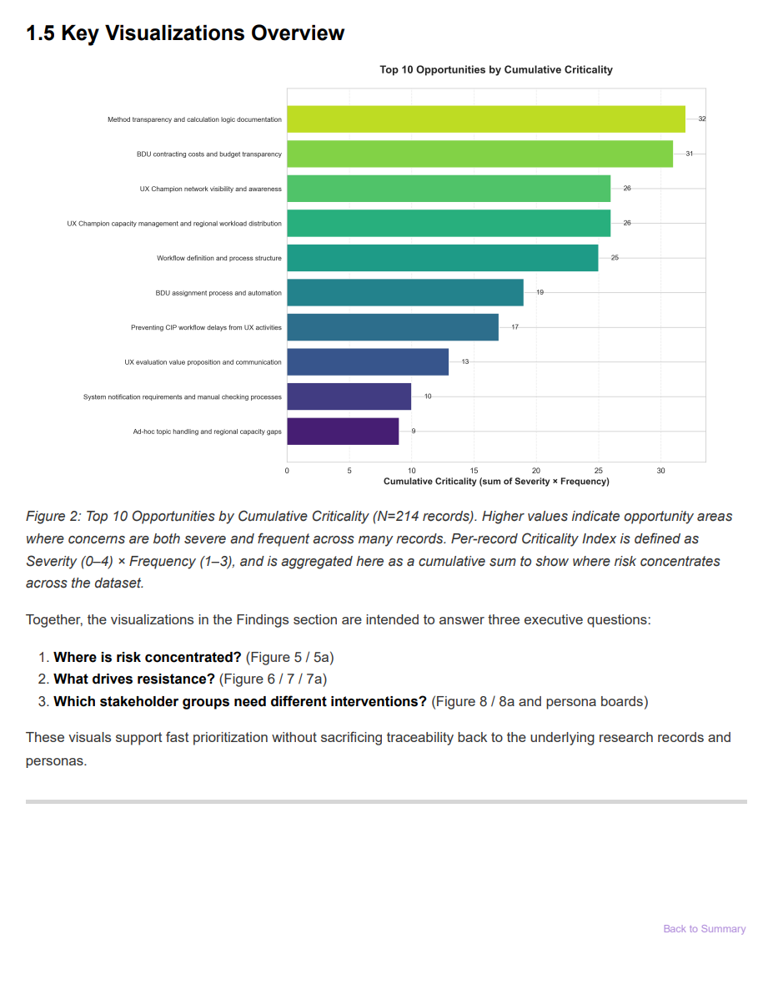

---

<!-- Slide 8 – Present (Academic Research & TrustMate) -->

<!-- _class: art-top-right -->

## Present – Academic Research (Trust in AI & UI)

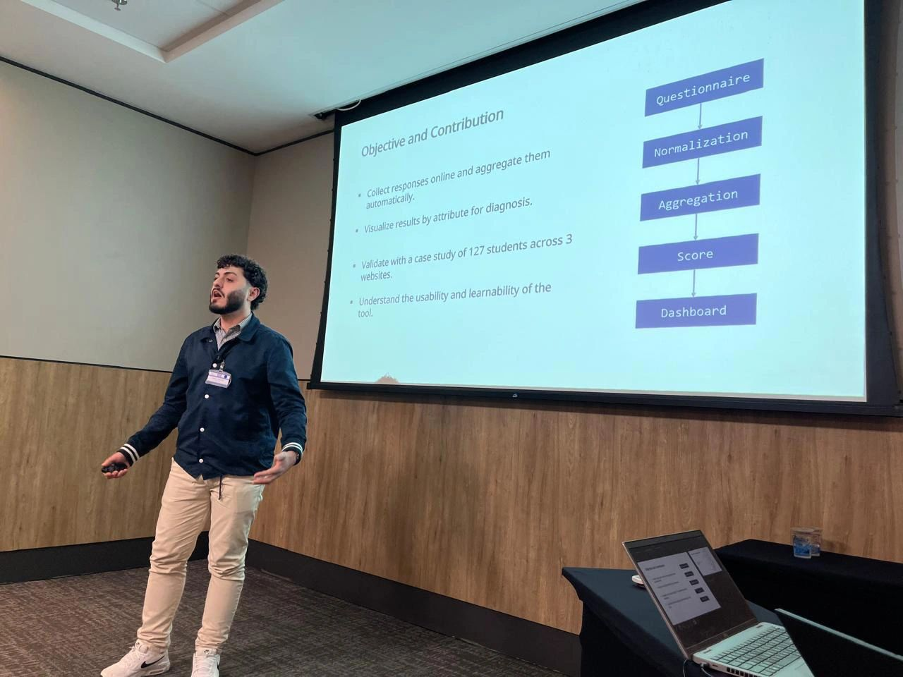

[INSERT DIAGRAM HERE: Academic research flow]

- **Master's focus:** Benchmark to assess software trustworthiness (Usability, Accessibility, UX). Thesis: quantitative methods for perceived trust in e-commerce and software interfaces.  
- **Publications:** ISSRE 2025 (HFSD – IEEE), IHC 2025 (SBC SOL). **TrustMate** + Power BI for trust scores; **AI agents as survey respondents**, full-stack development, Figma prototyping.  
- **Industry connection:** Methods and tools reusable for UX audits, maturity assessments, and CIP + UX work.

<!-- Mermaid source: academic-research-flow.mmd - render to academic-research-flow.png
flowchart TD
  Focus["Benchmark: Trustworthiness\nUsability, Accessibility, UX"]
  Pub["Publications\nISSRE 2025 HFSD, IHC 2025 SOL"]
  Tool["TrustMate + Power BI\nAI agents, full-stack, Figma"]
  Industry["Industry reuse\nUX audits, maturity, CIP+UX"]
  Focus --> Pub
  Focus --> Tool
  Pub --> Industry
  Tool --> Industry
-->  

---

<!-- Slide 9 – Present (Scientific Publications – Snapshot) -->

<!-- _class: dense-content article-images -->

## Present – Scientific Publications (Visual Evidence)

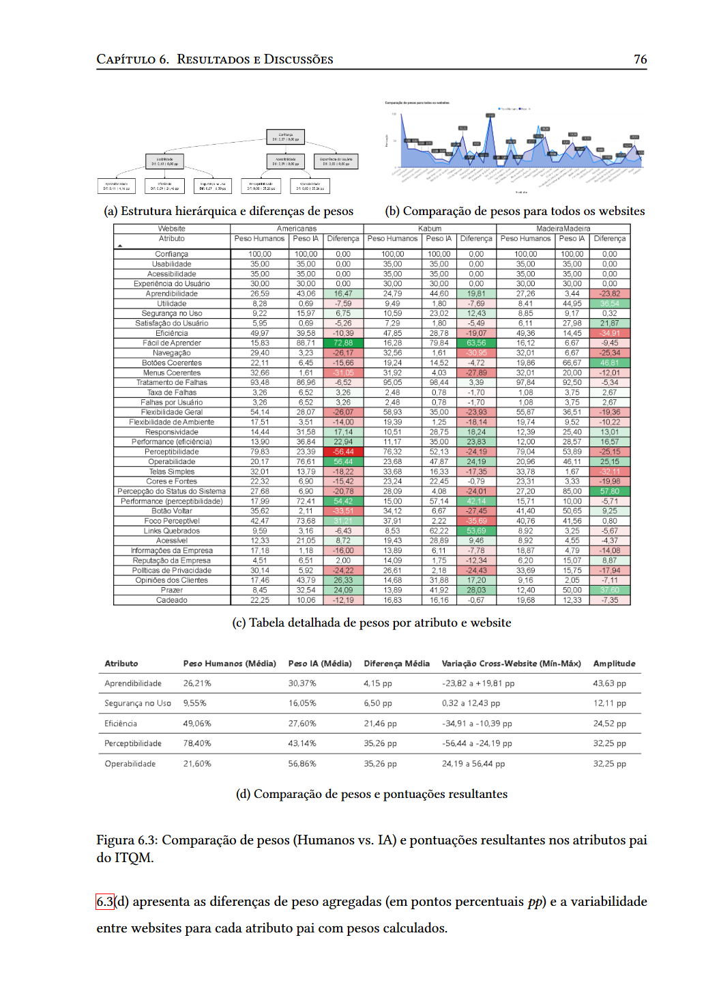

- Published work in **ISSRE 2025 (HFSD Workshop)** and **IHC 2025 (SBC SOL)**; master's dissertation on software trustworthiness.

---

<!-- Slide 10 – Present (CSI & NPS Performance 2024–2025) -->
<!-- Mermaid diagram source: csi-nps-performance.mmd - render to csi-nps-performance.png -->

## Present – CSI & NPS Performance (2024–2025)

- **High customer satisfaction** across eight UX projects delivered in 2024–2025. **Averages: CSI 4.86 / 5, NPS 9.94 / 10.** (Details in table below.)

---

<!-- Slide 11 – Present (Power BI Dashboards at Work) -->

<!-- _class: dense-content work-pbi-images -->

## Theme: Data Visualization – Power BI Dashboards at Work

- **Bosch UXGS Americas:** Power BI dashboards developed in role for project and resource oversight and for training tracking—supporting data-driven decision-making and governance.

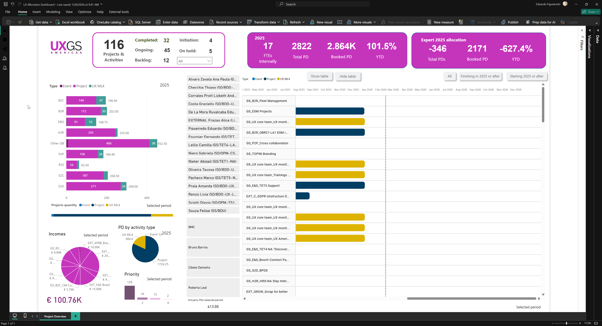

---

<!-- Slide 12 – Present (Dissertation: Power BI Visualizations) -->

<!-- _class: dense-content dissertation-pbi-images -->

## Theme: Data Visualization – Dissertation Power BI

- **Dissertation InfoVis (Power BI):** Dashboards and charts for trust-metrics analysis—variability of human scores across websites (Americanas, MadeiraMadeira, Kabum), AI × human homogeneity by attribute, and line comparisons (human vs AI scores per website). Supports validation of trust perception models and consolidation of research findings.

---

<!-- Slide 13 – Present (InfoVis Project – Power BI & PNAD Contínua) -->

<!-- _class: dense-content infovis-pbi-images -->

## Theme: Data Visualization – InfoVis Project (PNAD Contínua)

- **InfoVis class project – Power BI:** Built multi-page reports using **PNAD Contínua** (Brazil's National Household Sample Survey). Brazil’s National Household Sample Survey.
[INSERT DIAGRAM HERE: InfoVis PNAD visual structures]

- **Impact:** Demonstrates **Power BI** proficiency and **processing complex national research datasets** into clear, actionable visual insights for socioeconomic analysis.

<!-- Mermaid source: infovis-pnad-structures.mmd - render to infovis-pnad-structures.png
flowchart LR
  PNAD["PNAD Continua\nNational Survey Data"]
  Sankey["Sankey\nEducation-employment\nIncome flows"]
  Choropleth["Choropleth\nIncome by state"]
  Faceted["Faceted bar charts\nIncome by education\nhousehold, area"]
  PNAD --> Sankey
  PNAD --> Choropleth
  PNAD --> Faceted
-->

---

<!-- Slide 14 – Present (Dissertation: Technical Implementation & Impact) -->

## Theme: Technical Implementation – Dissertation (AI & Full Stack)

[INSERT DIAGRAM HERE: Dissertation tech pillars]

- **Architecture:** Database design supporting projects, experiments, attributes, scores, and agent runs.

<!-- Mermaid source: dissertation-tech-pillars.mmd - render to dissertation-tech-pillars.png optional
flowchart LR
  A["AI agents as\nsurvey respondents"]
  B["Full-stack\ndevelopment"]
  C["Figma\nlow-fidelity prototyping"]
  A --- B --- C
-->

<!-- Mermaid diagram source: dissertation-database-architecture.mmd -->

---

<!-- Slide 15 – Present (Dissertation: Technical Visuals) -->

<!-- _class: dense-content dissertation-tech-images -->

## Theme: Technical Implementation – Visual Evidence

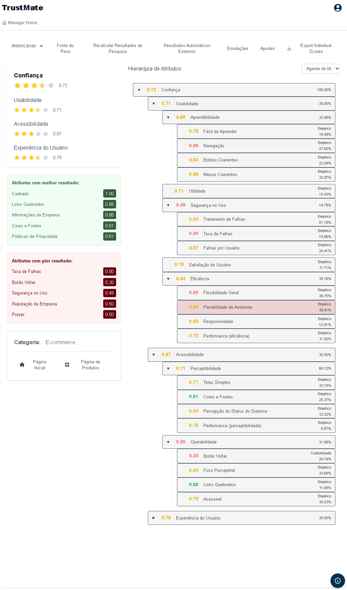

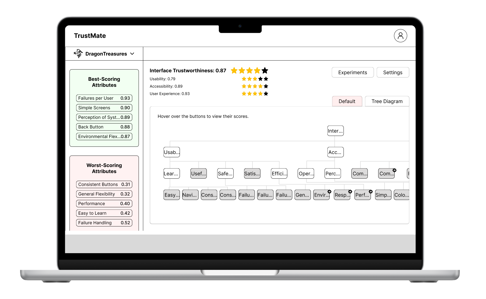

---

<!-- Slide 16 – Present (Tooling Project for PT) -->

<!-- _class: dense-content tooling-project-images -->

## Theme: Technical Implementation – Tooling Project for PT

- **Tooling project for PT:** Key development in **technical delivery and project management**—from requirements to high-fidelity deliverable, with **customer progress review meetings** throughout.

[INSERT DIAGRAM HERE: Tooling PT delivery workflow]

<!-- Mermaid source: tooling-pt-workflow.mmd - render to tooling-pt-workflow.png
flowchart LR
  W["Wireframe"]
  L["Low-fidelity\nprototype"]
  H["High-fidelity\nprototype"]
  W --> L --> H
  H --> Review["Customer progress\nreview meetings"]
  Review --> W
-->

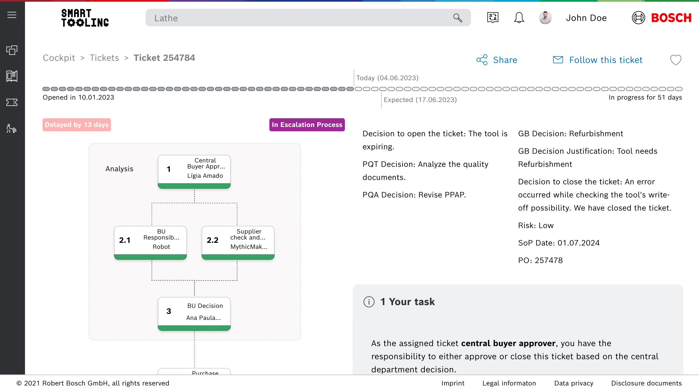

---

<!-- Slide 17 – Present (Proposal Generator – Excel VBA) -->

<!-- _class: art-top-right -->

## Theme: Technical Implementation – Proposal Generator (Excel VBA)

- **Definition:** Excel-based application for **automated proposal creation**—project proposals: define activities, estimate hours, Gantt-style timeline, and generate PowerPoint.
- **Generation logic:** Uses **predefined criteria and historical project data**; outputs (activities, hours, timeline) are driven by that logic.

[INSERT DIAGRAM HERE: Proposal Generator UX phases]

- **Technical proficiency:** Developed in **Excel VBA**—macros for automation, calculations, and presentation generation.

<!-- Mermaid source: proposal-generator-phases.mmd - render to proposal-generator-phases.png
flowchart LR
  P["Planning"]
  U["Understand"]
  S["Synthesize"]
  I["Ideate"]
  T["Test"]
  P --> U --> S --> I --> T
-->

---

<!-- Slide 18 – Present (InfoVis Project – PhraseNets Web Visualization) -->

<!-- _class: dense-content phrase-net-images -->

## Theme: Technical Implementation – PhraseNets Web Visualization

- **Course project – Information Visualization (InfoVis):** Developed a web-based PhraseNets visualization to explore relationships in text.\
- **Technique:** Implements PhraseNets pattern-based networks (e.g. subject–verb, verb–object) to reveal co-occurrence structures that standard charts miss.\
- **Why it matters:** Demonstrates proficiency in **web development** (interactive browser-based interface) and **advanced visual structures** beyond standard Power BI capabilities.

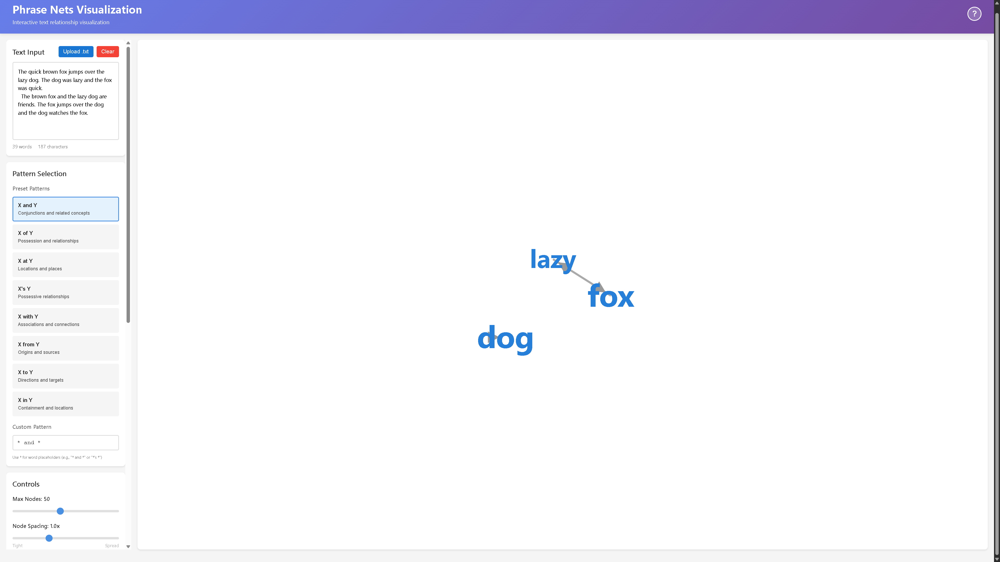

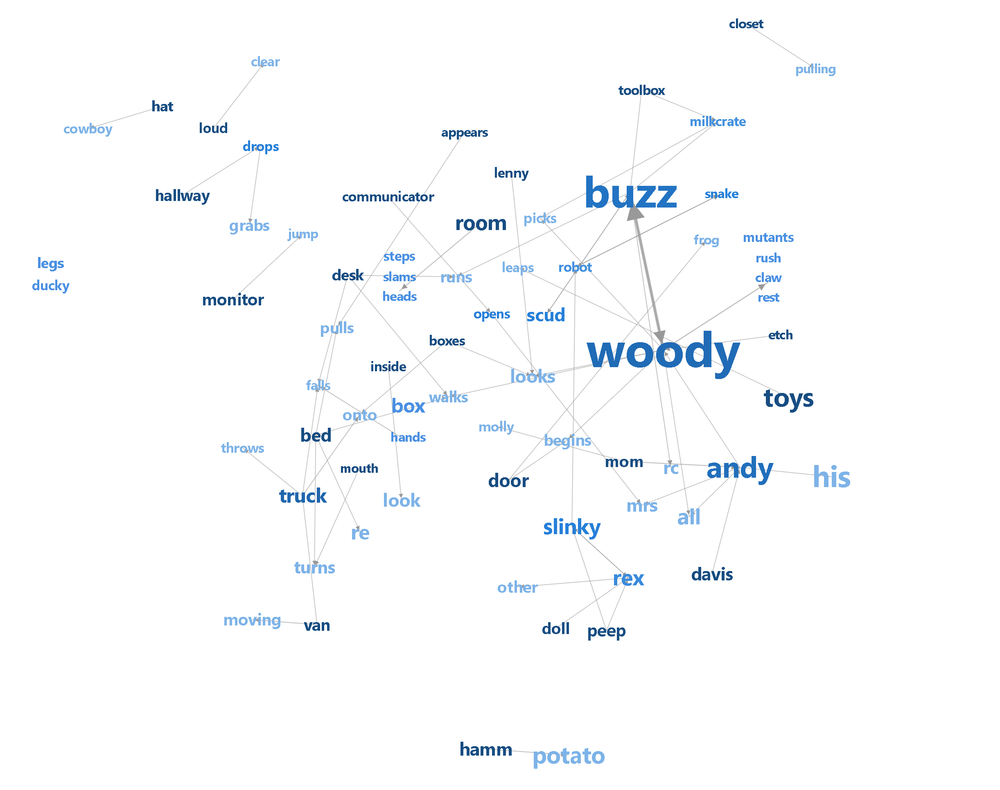

---

<!-- Slide 19 – Future (AI & Agile in Research) -->
<!-- Mermaid flowchart source: ai-agile-research.mmd - render to ai-agile-research.png -->

## Theme: Process & Future – AI & Agile in Research

- **Motivation:** Research projects often lack repeatable, quality-focused processes and clear accountability.  
- **Proposal:** Combine **AI assistance** with **Scrum practices** to improve throughput, transparency, and quality.  
- **Approach:**

[INSERT DIAGRAM HERE: AI and Agile in Research]

- **Guardrails:** AI outputs treated as drafts; strong focus on reproducibility, data privacy, and explicit quality criteria.

<!-- Mermaid source: ai-agile-research.mmd
flowchart TD
  subgraph roles [Roles]
    RPO["Research Product Owner"]
    RSM["Research Scrum Master"]
    RT["Research Team\ncollaborators + AI tools"]
  end
  subgraph ceremonies [Ceremonies]
    C1["Sprint planning\nBacklog refinement"]
    C2["Daily check-ins\nReviews\nRetrospectives"]
  end
  subgraph artifacts [Artifacts]
    A1["Research backlog\nExperiment cards"]
    A2["Dashboards and tools\nAI-generated drafts\nhuman-reviewed"]
  end
  roles --> ceremonies
  ceremonies --> artifacts
-->  

---

<!-- Slide 20 – Present (Innovation & Awards) -->

<!-- _class: art-top-right compact-list -->

## Theme: Process & Innovation – Awards

[INSERT TABLE HERE: Awards]

| Award | Place | Year / Context |
| ----- | ----- | -------------- |
| X-Games Brazil | 1st | 2018 – New Business Creation / Consultancy |
| Bosch Talent Forum | 3rd | 2018 – Project Management Software |
| Bosch Intern Talent Forum | 3rd | 2018 – Intern projects |
| NGO Hospitalhaços | Volunteer | Admin – social impact and community engagement |  

---

<!-- Slide 21 – Past (Experience Timeline) -->

<!-- _class: art-top-right dense-content -->

## Theme: Process – Experience Timeline (Condensed)

- **Trajectory across Bosch locations:** Brazil, Hungary (Budapest), Germany, Argentina.

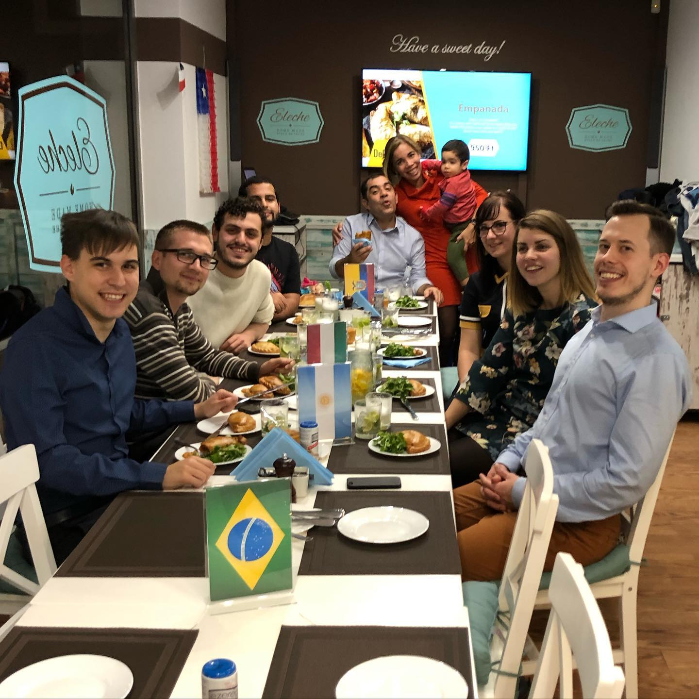

[INSERT DIAGRAM HERE: Experience timeline]

<!-- Mermaid source: experience-timeline.mmd - render to experience-timeline.png
timeline
    title Experience Timeline
    2017-2018 : Intern – Bosch Brasil : VBA, Continuous Improvement, internal communication
    2019 : Digitization Support Analyst – Bosch Magyarország Budapest : Business Excellence, VS Code, SQL Server, IIS
    2021-2023 : Web Developer – Bosch Brasil : Technology, React, Scrum; requirements to production
-->  

---

<!-- Slide 22 – Future (Career Aspirations, Vacancy Types & Strategic Views) -->

## Future – Career Aspirations, Vacancy Types & Strategic Views

<!-- Mermaid timeline source: future-career-timeline.mmd -->

- **Future objective:** Work in **technology-focused roles** that integrate **in-depth research, project management, and AI implementation** as a core professional interest.  
- **Desired vacancy types (Bosch & external):**

[INSERT TABLE HERE: Future vacancy types and examples]

| Type | Bosch examples | External examples |
| ---- | -------------- | ----------------- |
| Researcher / Senior | Global Service Solutions – service platforms, internal tools | Trust & Safety – trust, safety, fairness at scale |
| Technology / PM Lead | Digital / Enterprise Applications – B2B tools for service teams | — |
| Scrum Master / Agile Coach | — | Data-informed, research-oriented facilitation |
| Researcher advanced tech | — | Quantum & AI – technology and human factors |  
- **Target roles:** Researcher, Technology / Project Management Lead, Scrum Master, or Researcher in advanced tech contexts.  
- **Scrum Master role – focus:** Data-informed, research-oriented agile facilitation for technology, AI, and trustworthiness projects; project management and delivery quality.  
- **Core Scrum Master responsibilities:** Maintain **data integrity** and ensure **statistical relevance** across experiments and project lifecycles; oversee the **rigorous application of scientific methods** and the **adequate use of AI** to accelerate deliverables (never replacing human judgment); manage project timelines to **prevent stagnation and perpetual postponement**.  
- **Proactive strategies for communication blockers:** If appointment requests are not answered, deploy short, targeted surveys to collect decisions and unblock work; if surveys are not completed, schedule **mandatory 10-minute sessions** to secure answers and align expectations.  
- **Stakeholder engagement protocols:** Maintain **direct customer contact** to guarantee delivery of agreed outcomes; ensure customers are held **accountable for supporting project deliverables**, including providing data, approvals, and access needed to move forward.  
- **Strategic View A – "Paradise" (Quantum Computing):** Deep technical research and experimentation in quantum computing and advanced R&D. Leverages analytical skills, experimentation mindset, and physics background.  
- **Strategic View B – "Modest" (Scrum / Agile Leadership):** Scrum Master or agile leader enabling teams to deliver high-quality products. Builds on CIP, project management, facilitation, and coaching.  
- **Shared assets:** In-depth research, technology, project management, CIP integration, AI + agile methodology, and data-driven decision-making.

---

<!-- Slide 23 – Future (Personal Interests as Career Enablers) -->

<!-- _class: dense-content personal-images -->

## Future – Personal Interests that Power My Work

- **At home:** Two cats, beginner piano practice, and a split keyboard for macro creation and productivity.

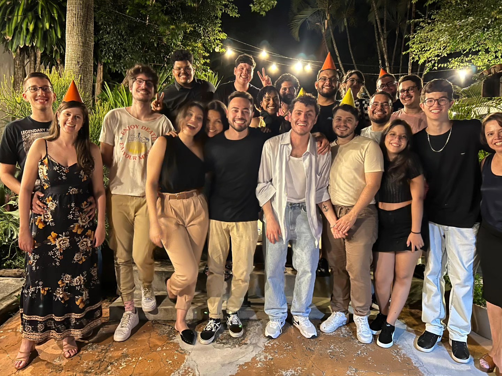

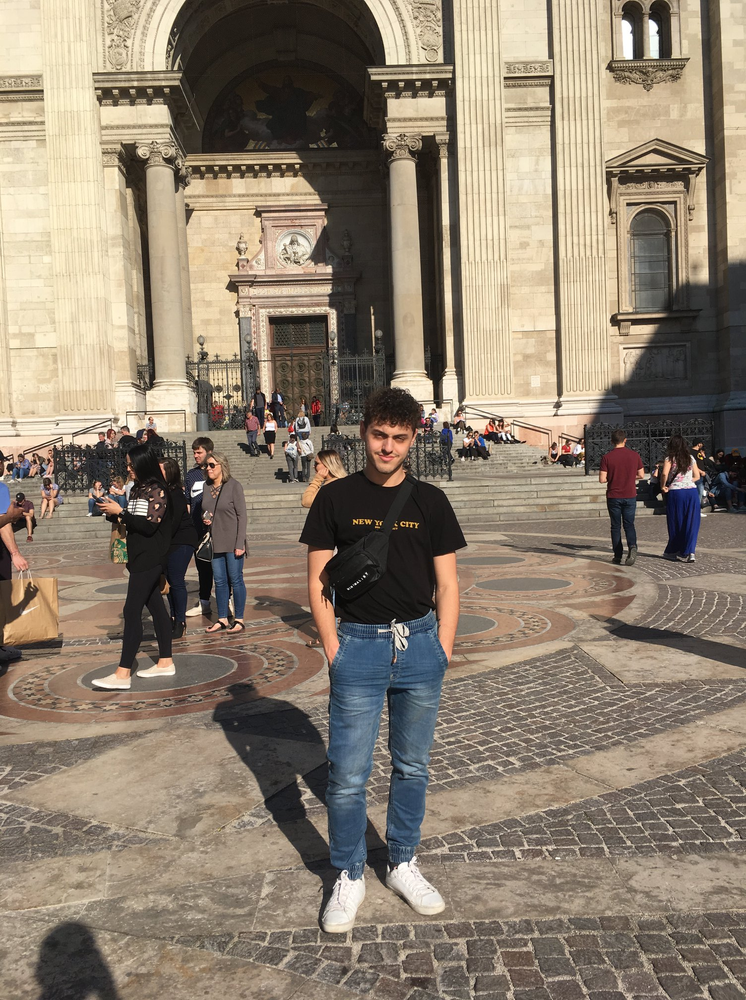

[INSERT TABLE HERE: Personal interests and career enablers]

| Interest | Career enabler |
| -------- | -------------- |
| Piano | Discipline, structured practice, performance under pressure |
| Linguistics (phonology & phonetics) | Clarity in copy; speech interfaces and accessibility |
| Physics (GR & Quantum) | Complex systems; quantum computing and advanced tech research |
| Acting | Empathy, storytelling, presence in interviews and workshops |
| Impressionist art | Nuanced perception and diverse perspectives in research |
| Macro creation | Automation and workflow optimization |
| Specialized keyboards | Ergonomics, productivity, technology and accessibility |  

---

<!-- Slide 26 – Closing & Contact -->

## Closing & Contact

[INSERT TABLE HERE: Closing – What I bring and contact]

**What I bring**

| Area | Summary |
| ---- | ------- |
| Core | In-depth Research, Technology & Project Management |
| Leadership | UX Maturity Level 4 – Americas |
| Milestone | CIP and UX Integration – Cursor IDE, AI, coding; Senior Researcher evolution |
| Research | Trust in interfaces; data-driven decision-making |

**Let's connect:** Email: edu.evangelista.figueiredo@gmail.com · LinkedIn: https://www.linkedin.com/in/eduardo-figueiredo · Resume PDF and this portfolio deck available on request.

---

<!-- Slide 27 – Blank Conclusion Page -->

<!-- _class: blank-midnight-blue -->
