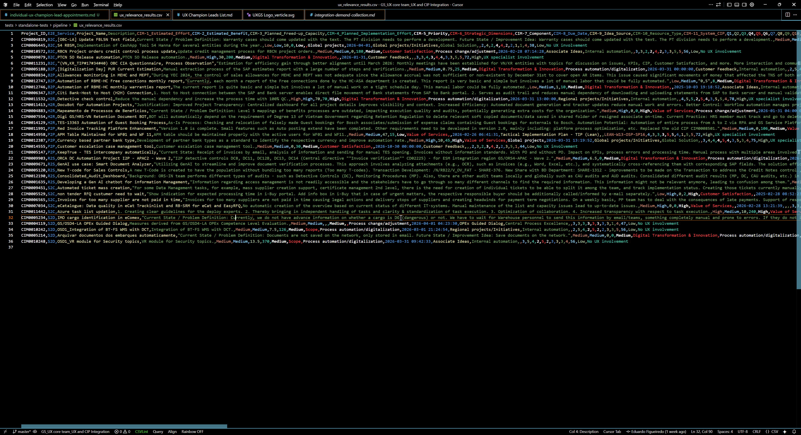
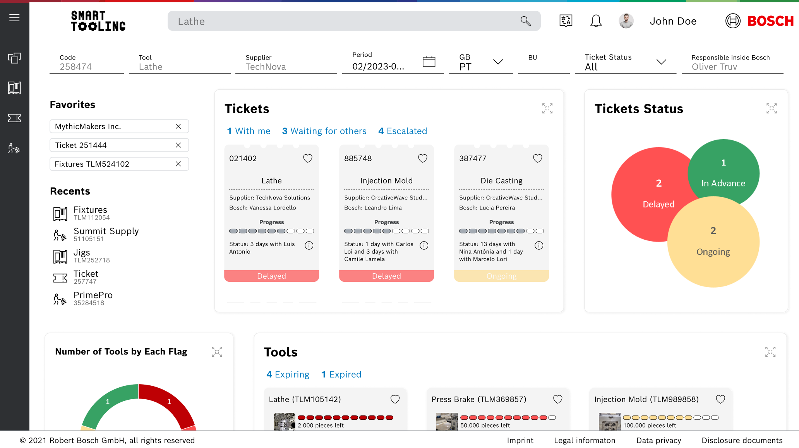
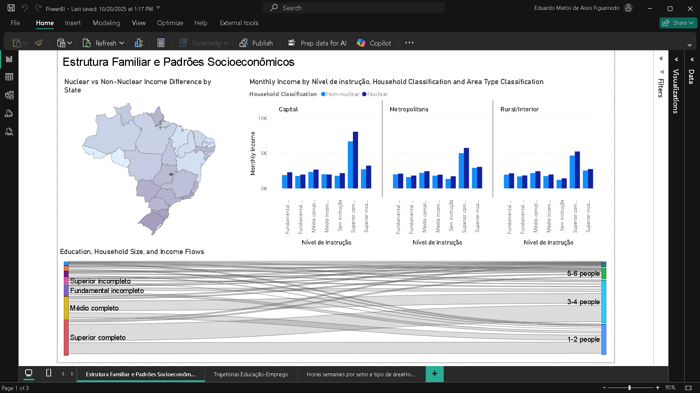
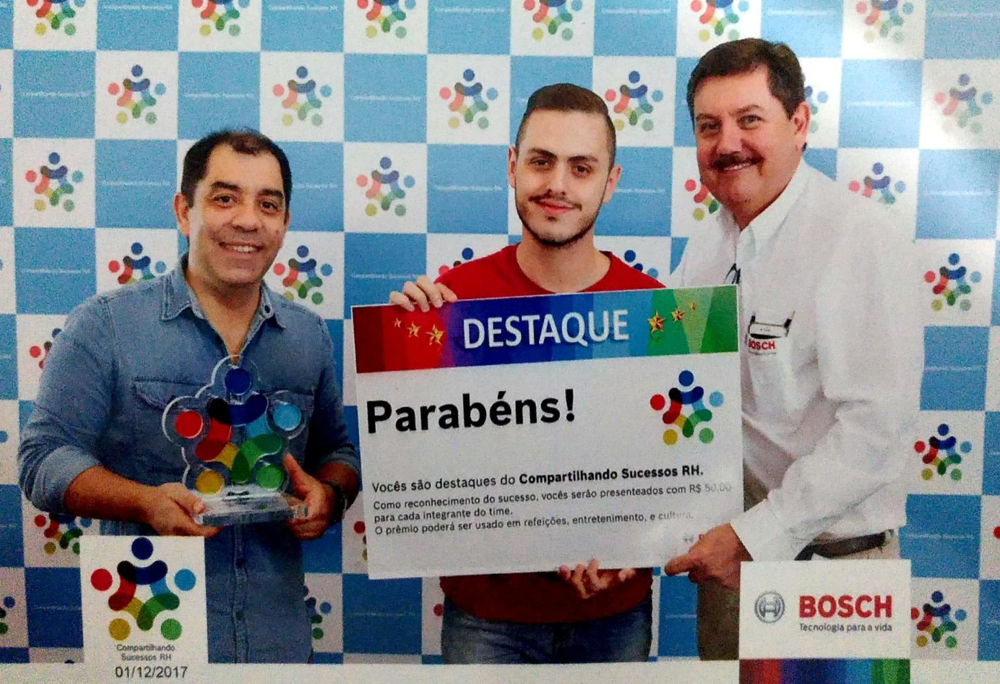
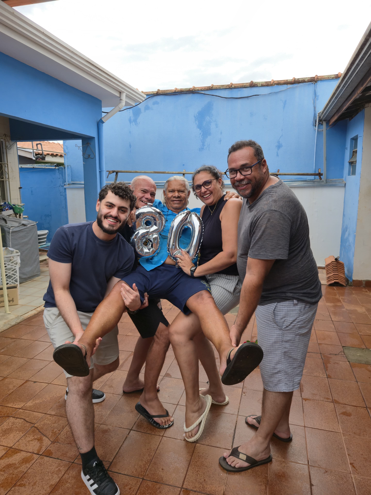
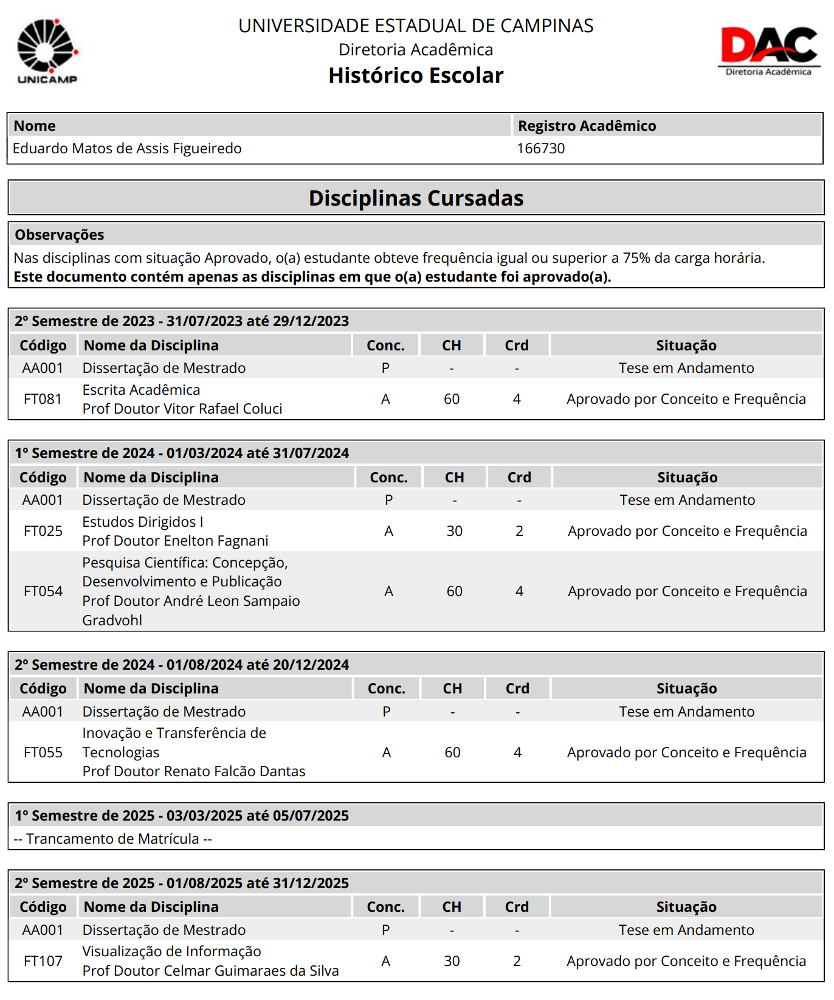
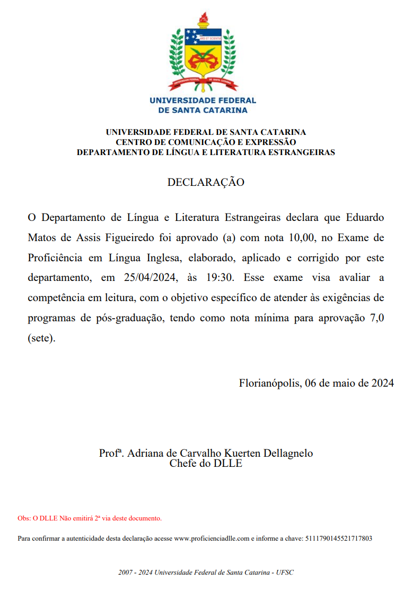
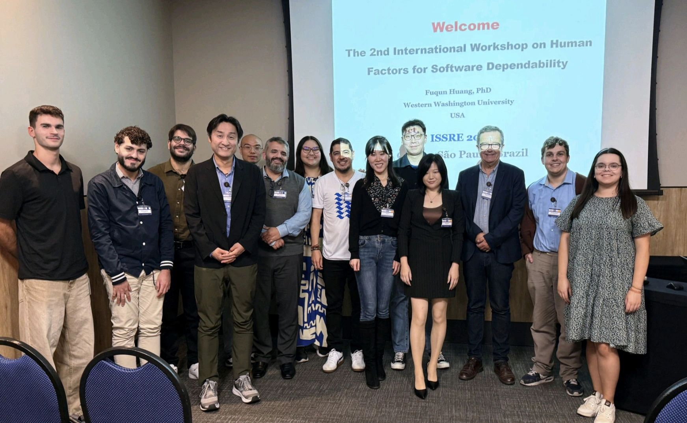
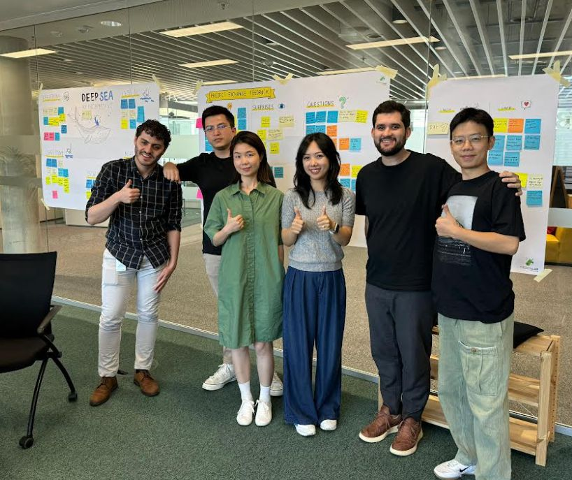
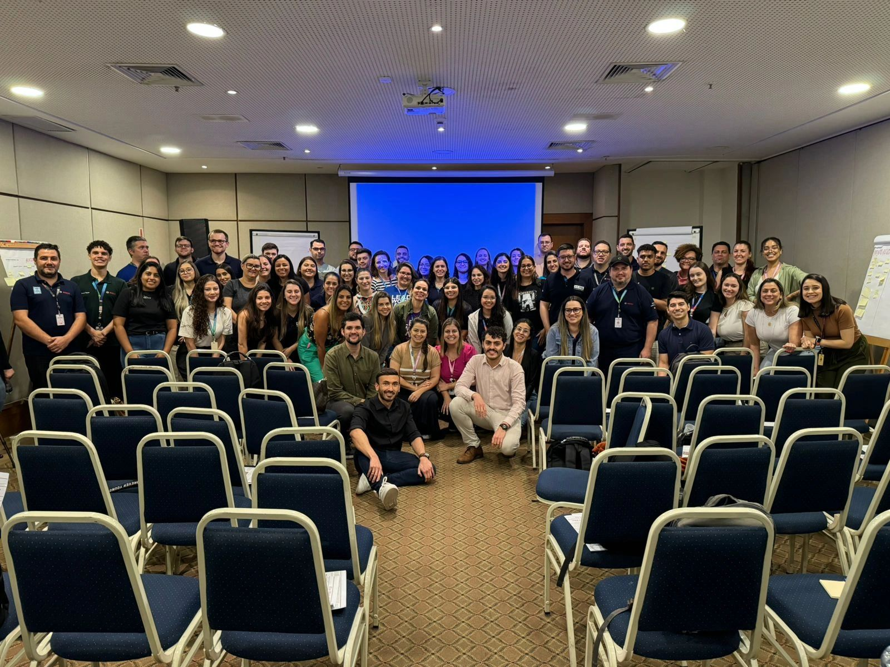

<!-- _class: lead -->

<!-- Slide 1 – Why (Golden Circle: Why) -->

# Why I Work With UX & Research
## Trustworthy, human-centered software for complex services

- I believe that software used in service organizations must be **trustworthy, usable, and inclusive**—especially when decisions affect people and businesses at scale.
- My work connects **UX research**, **front-end development**, and **Continuous Improvement (CIP)** so that user needs are built into processes, not added at the end.
- This portfolio tells that story: **past foundations** → **present impact** → **future directions**.

---

<!-- Slide 2 – Who I Am (Golden Circle: Who/What) -->

<!-- _class: art-top-right -->

## Who I Am – Snapshot

- **Name:** Eduardo M. de A. Figueiredo  
- **Role:** UX Researcher & Front-End Developer (Master's in Technology, Unicamp).  
- **Focus:** Integrating UX into **Continuous Improvement (CIP)** and **measuring software trustworthiness**.  
- **Impact:** Led the Americas region to **UX Maturity Level 4**, implemented **AI-driven UX quality gates**, and supported international projects (Hungary).  
- **Location & Contact:** Nova Odessa, SP – Brazil · `edu.evangelista.figueiredo@gmail.com` · LinkedIn / phone on request.  

---

<!-- Slide 3 – Past (Foundations: Education & Profile) -->

<!-- _class: art-top-right -->

## Past – Academic Foundations & Professional Profile

- **Master's in Technology – Information & Communication Systems (UX)** – Unicamp (2023–2025).  
  - Thesis: **Benchmark to assess software trustworthiness** via Usability, Accessibility, and UX.  
  - **Grade 'A' in all Master's coursework** — Official Unicamp transcript (Histórico Escolar) confirms top evaluation "Aprovado por Conceito e Frequência" in every completed discipline.  
  - **Master's courses:** Academic Writing (*Escrita Acadêmica*); Directed Studies I (*Estudos Dirigidos I*); Innovation and Technology Transfer (*Inovação e Transferência de Tecnologias*); Scientific Research (*Pesquisa Científica*); Information Visualization (*Visualização de Informação*).  
- **English proficiency (UFSC):** Reading comprehension for postgraduate programs – **10/10** (Apr 2024). Certificate in Appendix.  
- **Systems Analysis and Development** – Unicamp (2015–2020).  
- **Technical Degree in Computer Science** – ETEC Bento Quirino (2012–2014).  
- **Professional profile:** Proactive, self-reliant, organized; combines UX research, design, and front-end development with agile practices (Scrum, Kanban) and project management.  

---

<!-- Slide 4 – Past (Experience Timeline) -->

<!-- _class: art-top-right dense-content -->

## Past – Experience Timeline (Condensed)

- **Intern – Bosch Brasil (2017–2018):** VBA (Excel) solutions for Continuous Improvement and internal communication.  
- **Digitization Support Analyst – Bosch Magyarország (Budapest, 2019):** Business Excellence digitization using VS Code, SQL Server, and Windows Server (IIS).  
- **Web Developer – Bosch Brasil (2021–2023):** Web solutions with front-end focus; React and Scrum. Worked from **user pain points → prototypes → production** with cross-functional teams.  

---

<!-- Slide 5 – Present (Role & Strategic Impact) -->

<!-- _class: art-top-right -->

## Present – UX Research & Design Analyst (Bosch Brasil)

- **Role:** UX Research & Design Analyst – Bosch Brasil (May 2023 – present).  
- **UX Project Champion (GS/BDU):** Project Manager for the region.  
- **International assignments:** Two trips to Germany (2024 and 2025) to perform role-related responsibilities.  
- **CO2 Tracking (GS/UX):** First project completed within the UX department at GS. Scope: **marketing scouting for CO2 tracking telemetry**. Primary finding: research indicated a **lack of market demand**; conclusion that continued sales of the telemetry solution would be unsuccessful.  
- **UX Maturity Level 4 (Americas):** Led the region to **Level 4** by setting governance, templates, and training for service lines. Demonstrated systematic UX application to auditors.  
- **CIP + UX integration:** Led **"CIP and UX Integration"** as a critical career milestone—embedding UX checks into the Continuous Improvement workflow in ServiceNow CIM. Impact: stronger customer retention and revenue via user-centric service design; marked evolution toward Senior Researcher capabilities.  
- **Collaboration & teaching:** Applied scientific methods to identify service issues and design solutions. Tutor at **SENAI Digital Talent Academy**.  

---

<!-- Slide 6 – Present (CIP and UX Integration: Critical Career Milestone) -->

<!-- _class: art-top-right -->

## Present – CIP and UX Integration: A Critical Career Milestone

- **Career significance:** This project marks a pivotal evolution into **Senior Researcher** capabilities—combining deep, data-oriented investigation with technical execution and governance design.  
- **Project scope:** Integrated **UX relevance assessment** into the **Continuous Improvement Process (CIP)** in ServiceNow CIM. A **UX gate** sits between Assess and Approve; the method runs at that gate to triage improvement initiatives (Low / Medium / High UX relevance).  
- **Methodology—developer skills for research:** Utilized **Cursor IDE**, **AI-assisted coding**, and version-controlled Python pipelines to conduct research. Workflow: (1) **iterative code-based documentation** (Markdown, method.md v2.8); (2) **AI-assisted analysis** of N=214 research records and UX maturity data; (3) **automated pipeline** (extract → aggregate → calculate scores) producing `ux_relevance_results.csv` (N=35 projects); (4) **high-quality, data-oriented reports** in Markdown with executive summaries, Criticality Index (Severity × Frequency), and validation hypotheses.  
- **Deliverables:** **UX Relevance Quick Method** (10 system-calculated questions from 11 CIM fields; thresholds Low &lt;60, Medium 60–70, High ≥70); **1st Research Report** (January 2026) consolidating stakeholder inputs; **standalone pipeline** (`extract_cim_data.py`, `calculate_ux_scores.py`, `aggregate_to_csv.py`) with reproducible validation.  
- **Impact:** Governance clarity, reduced perceived delay, and reusable UX governance framework. Aligned CAP and UX into a unified, defensible solution.  

---

<!-- Slide 6b – Present (CIP and UX Integration: Research Artifacts & Visuals) -->

<!-- _class: dense-content cip-ux-images -->

## Present – CIP and UX Integration: Research Artifacts & Visuals

- **High-quality, data-oriented deliverables** produced using Markdown, Python pipelines, and Cursor IDE: (1) **1st Research Report** (January 2026)—"Make governance clear. Keep improvements moving."—consolidating N=214 records, executive summary, literature benchmark, methodology, findings, and strategic opportunities; (2) **UX Relevance Quick Method** (method.md v2.8)—CIM-to-Q1–Q10 mapping, scoring algorithm, post-evaluation workflow; (3) **Pipeline** (`tests/standalone-tests/pipeline/`)—extraction, aggregation, score calculation, validation. Distribution (N=35): Low 57.1%, Medium 20.0%, High 22.9%.

---

<!-- Slide 7 – Present (Power BI Dashboards at Work) -->

<!-- _class: dense-content work-pbi-images -->

## Present – Power BI Dashboards at Work

- **Bosch UXGS Americas:** Power BI dashboards developed in role for project and resource oversight and for training tracking—supporting data-driven decision-making and governance.

---

<!-- Slide 7b – Present (CSI & NPS Performance 2024–2025) -->
<!-- Mermaid diagram source: csi-nps-performance.mmd - render to csi-nps-performance.png -->

## Present – CSI & NPS Performance (2024–2025)

- **High customer satisfaction** across eight UX projects delivered in 2024–2025. **Averages: CSI 4.86 / 5, NPS 9.94 / 10.**
- **Projects:** GS_R2S_TET2-LA UI Design for Financial Portal (CSI 5) · EXT_PS_CCC Telemetry for light vehicles (CSI 5, NPS 10) · EXT_M-PUR36 Tooling Management (CSI 5, NPS 10) · EXT_M-PMQ PPAP Application (CSI 5, NPS 10) · GS_P2P_MovDiv_Improvement part 1 (CSI 5, NPS 10) · GS_P2P_Financial_Portal (CSI 5, NPS 10) · GS_UX Bootcamp 2024 Joinville—95 people (CSI 4.9, NPS 9.6) · GS_B2R_AA CF Automation (CSI 4, NPS 10).

---

<!-- Slide 8 – Present (Proposal Generator – Excel VBA) -->

<!-- _class: art-top-right -->

## Present – Proposal Generator (Excel VBA)

- **Definition:** Excel-based application for **automated proposal creation**—project proposals for UX activities: define activities, estimate hours, Gantt-style timeline, and generate PowerPoint.
- **Generation logic:** Uses **predefined criteria and historical project data**; outputs (activities, hours, timeline) are driven by that logic.
- **UX complexity:** Outputs are **categorized by UX complexity** (phases: Planning, Understand, Synthesize, Ideate, Test); the tool supports activity definition and visualization by these categories.
- **Technical proficiency:** Developed in **Excel VBA (Visual Basic for Applications)**—macros for automation, calculations, and presentation generation.

---

<!-- Slide 9 – Present (Tooling Project for PT) -->

<!-- _class: dense-content tooling-project-images -->

## Present – Tooling Project for PT

- **Tooling project for PT:** A key development in **design proficiency**—from wireframe to high-fidelity prototype, with collaborative **customer progress review meetings** throughout.
- **Design workflow:** **Wireframe** → **low-fidelity prototype** → **high-fidelity prototype**; iterative refinement with stakeholder feedback.
- **Collaboration:** Customer progress review meetings used to align on scope, validate flows, and sign off on deliverables at each stage.

---

<!-- Slide 10 – Present (Academic Research & TrustMate) -->

<!-- _class: art-top-right -->

## Present – Academic Research (Trust in AI & UI)

- **Master's research focus:** Creating a **benchmark to assess software trustworthiness** across three parameters: **Usability, Accessibility, and User Experience**. Thesis explores quantitative methods for evaluating perceived trust in e-commerce and software interfaces.  
- **Published articles:** **ISSRE 2025 (HFSD Workshop – IEEE):** *"Measuring Perceived Trust in Websites: A digital tool providing a score for evaluation"* – explores how Agentic AI can emulate trust perception and provides a digital scoring mechanism. **IHC 2025 (SBC SOL):** *"Interface Trustworthiness Score Definition Platform"* (co-authored with Regina Moraes, Andreia Casare) – published in **SOL (SBC Open Lib)**, presents a platform for defining and calculating interface trustworthiness scores.  
- **PowerBI in master's research:** **PowerBI dashboards** used extensively for data visualization and analysis of trust metrics. Dashboards aggregate usability, accessibility, and UX data to generate comprehensive trustworthiness scores. Enables interactive exploration of research findings, trend analysis across different interface types, and validation of trust perception models.  
- **Tooling:** **TrustMate** – digital tool to evaluate perceived trust in interfaces, integrated with PowerBI for real-time score visualization.  
- **Dissertation technologies:** **AI agents as survey respondents** – agentic AI completes trust/usability surveys (e.g. e-commerce evaluation), enabling scalable data collection for the benchmark and TrustMate. **Full-stack development** – frontend (TrustMate UI, survey and dashboard), backend (evaluation pipeline, score calculation), and database architecture for projects, experiments, attributes, scores, and agent runs. **Low-fidelity prototyping (Figma)** – iterative design of survey flows, evaluation screens, and TrustMate interface before implementation.  
- **Industry connection:** Methods and tools are reusable for UX audits, maturity assessments, and CIP + UX work.  

---

<!-- Slide 11 – Present (Dissertation: Technical Implementation & Impact) -->

<!-- _class: dense-content dissertation-tech-images -->

## Present – Dissertation: Technical Implementation & Impact

- **AI agents as survey respondents**, **full-stack development** (frontend, backend, database), and **Figma low-fidelity prototyping** – illustrated below.

<!-- Mermaid diagram source: dissertation-database-architecture.mmd -->

---

<!-- Slide 12 – Present (Dissertation: Power BI Visualizations) -->

<!-- _class: dense-content dissertation-pbi-images -->

## Present – Dissertation: Power BI Visualizations

- **Dissertation InfoVis (Power BI):** Dashboards and charts for trust-metrics analysis—variability of human scores across websites (Americanas, MadeiraMadeira, Kabum), AI × human homogeneity by attribute, and line comparisons (human vs AI scores per website). Supports validation of trust perception models and consolidation of research findings.

---

<!-- Slide 13 – Present (InfoVis Project – PhraseNets Web Visualization) -->

<!-- _class: dense-content phrase-net-images -->

## Present – InfoVis Project – PhraseNets Web Visualization

- **Course project – Information Visualization (InfoVis):** Developed a web-based PhraseNets visualization to explore relationships in text.\
- **Technique:** Implements PhraseNets pattern-based networks (e.g. subject–verb, verb–object) to reveal co-occurrence structures that standard charts miss.\
- **Why it matters:** Demonstrates proficiency in **web development** (interactive browser-based interface) and **advanced visual structures** beyond standard Power BI capabilities.

---

<!-- Slide 14 – Present (InfoVis Project – Power BI & PNAD Contínua) -->

<!-- _class: dense-content infovis-pbi-images -->

## Present – InfoVis Project – Power BI & PNAD Contínua

- **InfoVis class project – Power BI:** Built multi-page reports with advanced visual structures using **PNAD Contínua** (Pesquisa Nacional por Amostra de Domicílios Contínua), Brazil’s National Household Sample Survey.
- **Visual structures:** Sankey diagrams (education–employment trajectories; education, household size, and income flows), choropleth map (nuclear vs non-nuclear income by state), and faceted bar charts (monthly income by education, household type, and area). Processed and modeled complex national survey data for insight.
- **Impact:** Demonstrates **Power BI** proficiency and the ability to **process complex national research datasets** into clear, actionable visual insights for socioeconomic analysis.

---

<!-- Slide 15 – Present (Scientific Publications – Snapshot) -->

<!-- _class: dense-content article-images -->

## Present – Scientific Publications

- Published work in **ISSRE 2025 (HFSD Workshop)** and **IHC 2025 (SBC SOL)**; master's dissertation on software trustworthiness.

---

<!-- Slide 16 – Present (Innovation & Awards) -->

<!-- _class: art-top-right compact-list -->

## Present – Innovation & Awards

- **1st Place – X-Games Brazil 2018** – New Business Creation / Consultancy.  
- **3rd Place – Bosch Talent Forum 2018** – Project Management Software.  
- **3rd Place – Bosch Intern Talent Forum 2018** – Intern projects.  
- **Volunteer – NGO Hospitalhaços (Admin)** – social impact and community engagement.  

---

<!-- Slide 17 – Future (Career Aspirations, Vacancy Types & Strategic Views) -->

## Future – Career Aspirations, Vacancy Types & Strategic Views

<!-- Mermaid timeline source: future-career-timeline.mmd -->

- **Future objective:** Work in **technology-focused roles** that integrate **UX research skills with AI implementation and development** as a core professional interest.  
- **Desired vacancy types (Bosch & external):** UX Researcher / Senior UX Researcher, UX Lead or Manager, Scrum Master or Agile Coach for product teams, and Researcher roles in advanced tech (AI, quantum, data-intensive systems).  
- **Representative vacancy examples – Bosch:**  
  - UX Researcher – Bosch Global Service Solutions: research for service organization platforms and internal tools.  
  - UX Lead – Bosch Digital / Enterprise Applications: lead UX strategy and research for complex B2B tools used by service teams.  
- **Representative vacancy examples – external companies:**  
  - Senior UX Researcher – Trust & Safety at a global product company (e.g. large-scale e-commerce or cloud platform) focusing on **trust, safety, and fairness** in digital experiences.  
  - UX Researcher – Advanced Tech / Quantum & AI at a research-focused lab or big tech company, connecting **human factors, quantum/AI, and interface design**.  
- **Target roles:** UX Researcher, UX Lead, Scrum Master, or Researcher in advanced tech contexts.  
- **Scrum Master role – focus:** Data-informed, research-oriented agile facilitation for UX, AI, and trustworthiness projects, ensuring delivery quality and learning.  
- **Core Scrum Master responsibilities:** Maintain **data integrity** and ensure **statistical relevance** across experiments and project lifecycles; oversee the **rigorous application of scientific methods** and the **adequate use of AI** to accelerate deliverables (never replacing human judgment); manage project timelines to **prevent stagnation and perpetual postponement**.  
- **Proactive strategies for communication blockers:** If appointment requests are not answered, deploy short, targeted surveys to collect decisions and unblock work; if surveys are not completed, schedule **mandatory 10-minute sessions** to secure answers and align expectations.  
- **Stakeholder engagement protocols:** Maintain **direct customer contact** to guarantee delivery of agreed outcomes; ensure customers are held **accountable for supporting project deliverables**, including providing data, approvals, and access needed to move forward.  
- **Strategic View A – "Paradise" (Quantum Computing):** Deep technical research and experimentation in quantum computing and advanced R&D. Leverages analytical skills, experimentation mindset, and physics background.  
- **Strategic View B – "Modest" (Scrum / Agile Leadership):** Scrum Master or agile leader enabling teams to deliver high-quality products. Builds on CIP & UX experience, facilitation, and coaching.  
- **Shared assets:** UX research, CIP + UX integration, AI + agile methodology, and data-driven decision-making.

---

<!-- Slide 18 – Future (AI & Agile in Research) -->
<!-- Mermaid flowchart source: slide-9-diagram.mmd -->

## Future – AI & Agile in Research

- **Motivation:** Research projects often lack repeatable, quality-focused processes and clear accountability.  
- **Proposal:** Combine **AI assistance** with **Scrum practices** to improve throughput, transparency, and quality.  
- **Approach:** Roles: Research Product Owner, Research Scrum Master (me), Research Team (collaborators + AI tools). Ceremonies: sprint planning, backlog refinement, daily check-ins, reviews, retrospectives. Artifacts: research backlog, experiment cards, dashboards/tools, AI-generated drafts (human-reviewed).  
- **Guardrails:** AI outputs treated as drafts; strong focus on reproducibility, data privacy, and explicit quality criteria.  

---

<!-- Slide 19 – Future (Personal Interests as Career Enablers) -->

<!-- _class: dense-content personal-images -->

## Future – Personal Interests that Power My Work

- **Piano:** Discipline, structured practice, and performance under pressure – mirrors iterative design and delivery.  
- **Linguistics (phonology & phonetics):** Clarity in communication, better UX copy, and insights into speech interfaces and accessibility.  
- **Physics (GR & Quantum):** Comfort with complex systems and abstractions; aligns with research in **quantum computing** and advanced tech.  
- **Acting:** Empathy, storytelling, and presence in interviews, workshops, demos, and Scrum ceremonies.  
- **Impressionist art:** Appreciation for nuanced perception and subjective experience – informs user research and understanding diverse perspectives.  
- **Macro creation:** Expertise in automation and efficiency optimization – translates to workflow improvements and tool development in UX and development contexts.  
- **Specialized keyboard configurations:** Interest in ergonomic design and personalized interfaces – connects to accessibility research and user-centered design thinking.  

---

<!-- Slide 20 – Appendix (Academic Visuals Gallery) -->

<!-- _class: dense-content academic-images -->

## Appendix – Academic Visuals Gallery

- Including **Unicamp Histórico Escolar** (Master's transcript: grade 'A' in all coursework); **UFSC English Proficiency** (reading comprehension for postgraduate programs, 10/10, 2024).

---

<!-- Slide 21 – Appendix (Workshops & Teams Gallery) -->

<!-- _class: dense-content workshop-images -->

## Appendix – Workshops & Teams Gallery

---

<!-- Slide 22 – Closing & Contact -->

## Closing & Contact

- **What I bring:**  
  - UX Research & Front-End Development  
  - UX Maturity Level 4 leadership across the Americas  
  - **CIP and UX Integration** (critical milestone): deep, data-oriented research using Cursor IDE, AI, and coding; high-quality Markdown reports; Senior Researcher evolution  
  - Academic research on **trust in interfaces** and data-driven decision-making  
- **Let’s connect:**  
  - Email: `edu.evangelista.figueiredo@gmail.com`  
  - LinkedIn: `https://www.linkedin.com/in/eduardo-figueiredo`  
  - Resume PDF and this portfolio deck available on request.

---

<!-- Slide 23 – Blank Conclusion Page -->

<!-- _class: blank-midnight-blue -->
