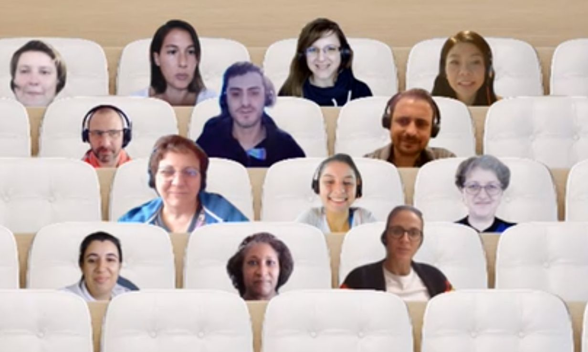

<!-- _class: lead -->

<!-- Slide 1 – Why (Golden Circle: Why) -->

# Why I Work With UX & Research
## Trustworthy, human-centered software for complex services

- I believe that software used in service organizations must be **trustworthy, usable, and inclusive**—especially when decisions affect people and businesses at scale.
- My work connects **UX research**, **front-end development**, and **Continuous Improvement (CIP)** so that user needs are built into processes, not added at the end.
- This portfolio tells that story: **past foundations** → **present impact** → **future directions**.

---

<!-- Slide 2 – Who I Am (Golden Circle: Who/What) -->

<!-- _class: art-top-right -->

## Who I Am – Snapshot

- **Name:** Eduardo M. de A. Figueiredo  
- **Role:** UX Researcher & Front-End Developer (Master's in Technology, Unicamp).  
- **Focus:** Integrating UX into **Continuous Improvement (CIP)** and **measuring software trustworthiness**.  
- **Impact:** Led the Americas region to **UX Maturity Level 4**, implemented **AI-driven UX quality gates**, and supported international projects (Hungary).  
- **Location & Contact:** Nova Odessa, SP – Brazil · `edu.evangelista.figueiredo@gmail.com` · LinkedIn / phone on request.  

---

<!-- Slide 3 – Past (Foundations: Education & Profile) -->

<!-- _class: art-top-right -->

## Past – Academic Foundations & Professional Profile

- **Master's in Technology – Information & Communication Systems (UX)** – Unicamp (2023–2025).  
  - Thesis: **Benchmark to assess software trustworthiness** via Usability, Accessibility, and UX.  
  - A-grade average across all classes.  
- **Systems Analysis and Development** – Unicamp (2015–2020).  
- **Technical Degree in Computer Science** – ETEC Bento Quirino (2012–2014).  
- **Professional profile:** Proactive, self-reliant, organized; combines UX research, design, and front-end development with agile practices (Scrum, Kanban) and project management.  

---

<!-- Slide 4 – Past (Experience Timeline) -->

<!-- _class: art-top-right dense-content -->

## Past – Experience Timeline (Condensed)

- **Intern – Bosch Brasil (2017–2018):** VBA (Excel) solutions for Continuous Improvement and internal communication.  
- **Digitization Support Analyst – Bosch Magyarország (Budapest, 2019):** Business Excellence digitization using VS Code, SQL Server, and Windows Server (IIS).  
- **Web Developer – Bosch Brasil (2021–2023):** Web solutions with front-end focus; React and Scrum. Worked from **user pain points → prototypes → production** with cross-functional teams.  

---

<!-- Slide 5 – Present (Role & Strategic Impact) -->

<!-- _class: art-top-right -->

## Present – UX Research & Design Analyst (Bosch Brasil)

- **Role:** UX Research & Design Analyst – Bosch Brasil (May 2023 – present).  
- **UX Maturity Level 4 (Americas):** Led the region to **Level 4** by setting governance, templates, and training for service lines. Demonstrated systematic UX application to auditors.  
- **CIP + UX integration:** Managed **"Integrating UX Quality Gates"** – embedding UX checks into CIP using AI and automation. Impact: stronger customer retention and revenue via user-centric service design.  
- **Collaboration & teaching:** Applied scientific methods to identify service issues and design solutions. Tutor at **SENAI Digital Talent Academy**.  

---

<!-- Slide 6 – Present (CIP, UX & Tooling) -->

<!-- _class: art-top-right -->

## Present – CIP, UX & Tooling

- **CIP & UX integration:** Connects Continuous Improvement practices with UX research and design activities. Ensures UX is a **mandatory gate**, not an optional step.  
- **Methodology & tools:** Uses AI and automation to enforce UX quality gates within service lines. Supports decision-making with **Power BI dashboards** and structured reports.  
- **Results:** Aligned CAP (Continuous Improvement) and UX into a unified solution. Created a reusable framework for UX governance across projects.  

---

<!-- Slide 7 – Present (Academic Research & TrustMate) -->

<!-- _class: art-top-right -->

## Present – Academic Research (Trust in AI & UI)

- **Research focus:** Quantifying perceived trust in e-commerce and software interfaces.  
- **Publications:** **ISSRE 2025 (HFSD Workshop):** *"Measuring Perceived Trust in Websites: A digital tool providing a score for evaluation"* – explores how Agentic AI can emulate trust perception. **IHC 2025:** *"Interface Trustworthiness Score Definition Platform"* (with Regina Moraes, Andreia Casare) – published in **SOL (SBC Open Lib)**.  
- **Tooling:** **TrustMate** – digital tool to evaluate perceived trust in interfaces.  
- **Industry connection:** Methods and tools are reusable for UX audits, maturity assessments, and CIP + UX work.  

---

<!-- Slide 8 – Present (Innovation & Awards) -->

<!-- _class: art-top-right compact-list -->

## Present – Innovation & Awards

- **1st Place – X-Games Brazil 2018** – New Business Creation / Consultancy.  
- **3rd Place – Bosch Talent Forum 2018** – Project Management Software.  
- **3rd Place – Bosch Intern Talent Forum 2018** – Intern projects.  
- **Volunteer – NGO Hospitalhaços (Admin)** – social impact and community engagement.  

---

<!-- Slide 9 – Future (Professional Goals & Strategic Views) -->

## Future – Professional Goals & Strategic Views

- **Future objective:** Work in **technology-focused roles** that integrate **UX research skills with AI implementation and development** as a core professional interest.  
- **Target roles:** UX Researcher, UX Lead, Scrum Master, or Researcher in advanced tech contexts.  
- **Strategic View A – "Paradise" (Quantum Computing):** Deep technical research and experimentation in quantum computing and advanced R&D. Leverages analytical skills, experimentation mindset, and physics background.  
- **Strategic View B – "Modest" (Scrum / Agile Leadership):** Scrum Master or agile leader enabling teams to deliver high-quality products. Builds on CIP & UX experience, facilitation, and coaching.  
- **Shared assets:** UX research, CIP + UX integration, AI + agile methodology, and data-driven decision-making.

---

<!-- Slide 10 – Future (AI & Agile in Research) -->
<!-- Mermaid diagram source: slide-9-diagram.mmd -->

## Future – AI & Agile in Research

- **Motivation:** Research projects often lack repeatable, quality-focused processes and clear accountability.  
- **Proposal:** Combine **AI assistance** with **Scrum practices** to improve throughput, transparency, and quality.  
- **Approach:** Roles: Research Product Owner, Research Scrum Master (me), Research Team (collaborators + AI tools). Ceremonies: sprint planning, backlog refinement, daily check-ins, reviews, retrospectives. Artifacts: research backlog, experiment cards, dashboards/tools, AI-generated drafts (human-reviewed).  
- **Guardrails:** AI outputs treated as drafts; strong focus on reproducibility, data privacy, and explicit quality criteria.  

---

<!-- Slide 11 – Future (Personal Interests as Career Enablers) -->

<!-- _class: art-top-right dense-content -->

## Future – Personal Interests that Power My Work

- **Piano:** Discipline, structured practice, and performance under pressure – mirrors iterative design and delivery.  
- **Linguistics (phonology & phonetics):** Clarity in communication, better UX copy, and insights into speech interfaces and accessibility.  
- **Physics (GR & Quantum):** Comfort with complex systems and abstractions; aligns with research in **quantum computing** and advanced tech.  
- **Acting:** Empathy, storytelling, and presence in interviews, workshops, demos, and Scrum ceremonies.  
- **Impressionist art:** Appreciation for nuanced perception and subjective experience – informs user research and understanding diverse perspectives.  
- **Macro creation:** Expertise in automation and efficiency optimization – translates to workflow improvements and tool development in UX and development contexts.  
- **Specialized keyboard configurations:** Interest in ergonomic design and personalized interfaces – connects to accessibility research and user-centered design thinking.  

---

<!-- Slide 12 – Closing & Contact -->

## Closing & Contact

- **What I bring:**  
  - UX Research & Front-End Development  
  - UX Maturity Level 4 leadership across the Americas  
  - CIP + UX integration and AI-assisted processes  
  - Academic research on **trust in interfaces** and data-driven decision-making  
- **Let’s connect:**  
  - Email: `edu.evangelista.figueiredo@gmail.com`  
  - LinkedIn: `https://www.linkedin.com/in/eduardo-figueiredo`  
  - Resume PDF and this portfolio deck available on request.
