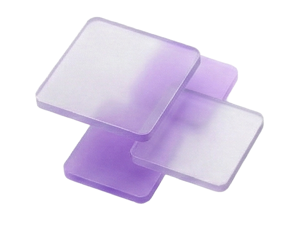

<!-- _class: lead -->

<!-- Section 1 – Cover & Overview -->

# Eduardo Figueiredo
## UX Researcher & Front-End Developer
*Bridging Human Factors, AI, and Organizational Process Maturity.*

**Key stats:** Master's in Technology (Unicamp) | UX Maturity Level 4 Leader (Americas) | International Experience (Hungary)

---

## Portfolio Overview

- About Me & Strengths (Professional + Personal)  
- Academic Achievement (Master's, thesis, publications)  
- Professional Experience & **Strategic Impact (UX Maturity Level 4)**  
- **Process Innovation** – UX Quality Gates in CIP  
- Master's Dissertation, **Academic Research (Trust in AI & UI)**, Tooling  
- Innovation & Awards  
- Professional Goals & Strategic Career Views (Paradise / Modest)  
- Personal Interests  
- AI & Agile Research Proposal (Summary)  
- Closing & Contacts  

---

<!-- Section 2 – About Me & Strengths -->

## About Me

- **Professional:** UX Researcher & Front-End Developer (Master's in Technology, Unicamp). I integrate UX into organizational processes (CIP), measure software trustworthiness, and have led the Americas region to **UX Maturity Level 4** and embedded UX quality gates into CIP using AI. International experience (Hungary); background in full-stack development and continuous improvement.  
- **Personal:** I bring the same curiosity and discipline to life outside work: linguistics (phonology, phonetics, IPA), piano and music theory, and deep dives into General Relativity, Quantum Physics, and Taoism. That mix supports attention to detail, structured creativity, and abstract thinking—all of which I apply to complex product and research challenges.  

---

<!-- _class: compact-list -->

## Professional Strengths (The "Hybrid" Advantage)

1. **Multidisciplinary expertise:** Rare combination of **UX Research** and **IT/Development**—Python, AutoHotkey, Vue.js, Machine Learning, Web Scraping—so I can own the full path from user insight to implementation.  
2. **Strategic leadership:** Led the Americas region to **UX Maturity Level 4**; drove integration of UX into the **Continuous Improvement Process (CIP)** using AI and automation. Proven ability to scale UX governance and impact.  
3. **Academic rigor:** Master's focus on **quantifying perceived trust in e-commerce** (SSL, UI flexibility); contributions to **ISSRE** and **IHC**; research mindset that strengthens evidence-based design and experimentation.  

---

## Personal Strengths & Traits

1. **Analytical precision:** Interest in **linguistics** (phonology, phonetics, IPA) reflects attention to detail and clarity in communication—valuable in UX copy, research protocols, and cross-functional alignment.  
2. **Disciplined creativity:** **Piano and music theory** practice demonstrates sustained dedication and structured learning; translates into iterative design, consistent quality, and creative problem-solving under constraints.  
3. **Intellectual curiosity:** Engagement with **General Relativity, Quantum Physics, and Taoism** illustrates comfort with abstract thinking and complex systems—a mindset that supports innovation, research design, and long-term career growth (e.g. quantum computing research direction).  

---

<!-- Section 3 – Academic Achievement -->

## Master's Program

- **Master's in Technology: Information & Communication Systems, UX** – Unicamp (2023–2025).  
- *Thesis:* Creating a benchmark to assess software trustworthiness via Usability, Accessibility, and UX.  
- A-grade average across all master's classes.  

---

## Degrees

- **Master's in Technology** (Info & Comm Systems, UX) – Unicamp (2023–2025).  
- **Systems Analysis and Development** – Unicamp (2015–2020).  
- **Technical Degree** – Computer Science – ETEC Bento Quirino (01/2012–12/2014).  

---

<!-- Section 4 – Professional Experience -->

## Professional Experience – Overview

- **Bosch Brasil:** UX Research & Design Analyst (2023–present), Web Developer (2021–2023).
- **Bosch Magyarország (Hungary):** Digitization Support Analyst (2019).
- **Bosch Brasil:** Intern (2017–2018).  

---

## Strategic Impact – UX Maturity Level 4

- **Project:** Achieving UX Maturity Level 4 for Bosch Americas service unit (Dec 2025).
- **Role:** Project Manager & Lead Researcher.
- **Outcome:** Successfully demonstrated systematic UX application to auditors.
- **Impact:** Empowered service lines with UX governance; increased customer retention and business revenue through user-centric product design.

---

## UX Research & Design Analyst – Bosch Brasil (May 2023 – Present)

- **Leadership:** Led Americas region to **UX Maturity Level 4** (Dec 2025) – governance, templates, training for service lines.
- **Process integration:** Managed "Integrating UX Quality Gates" project – UX embedded into CIP using AI and automation (customer satisfaction and revenue).
- **Global collaboration:** Identified service unit issues using scientific methods; designed and delivered appropriate solutions.
- Tutor at SENAI Digital Talent Academy.  

---

## Web Developer – Bosch Brasil (May 2021 – Nov 2023)

- Web solutions with focus on front-end technologies and teamwork-driven development.
- React, Scrum; User Research and Design, pain points to prototypes.  

---

## Early Experience – Robert Bosch

- **Digitization Support Analyst** (Budapest, Hungary, Jan–Dec 2019): Business Excellence digitization – VS Code, SQL Server, Windows Server (IIS).
- **Intern** (Campinas, 2017–2018): VBA (Excel) for Continuous Improvement and internal communication.  

---

<!-- Section 5 – CIP & UX Integration / Methodology -->

## CIP & UX Integration

- Goals, scope, and impact of CIP & UX integration at Bosch.  

---

## Process Innovation – UX Quality Gates in CIP

- **Project:** Integrating UX Quality Gates into the Continuous Improvement Process (CIP).  
- **Methodology:** AI and automation to ensure mandatory UX checks within business service lines.  
- **Result:** Unified solution bridging CAP (Continuous Improvement) and UX – user needs are met before product release.  

---

## Methodology – Method Two

- Overview of methods used, with emphasis on **Method Two**.  
- Where Method Two fits in the CIP + UX process.  

---

## CIP + UX & User Experience

- How CIP practices connect with UX research and design activities.  

---

## CIP & UX – Report & Results (Placeholder)

- Placeholder for detailed **CIP & UX integration report** (structure, key findings).  
- Placeholder for **Power BI dashboard** screenshots and KPI descriptions.  
- Placeholder for **tooling results and case studies** (before/after metrics, experiments).  

---

<!-- Section 6 – Master's Dissertation & Data Artifacts -->

## Academic Research – Trust in AI & UI

- **Focus:** Quantifying perceived trust in e-commerce and software interfaces.  
- **ISSRE 2025 (HFSD Workshop):** "Measuring Perceived Trust in Websites: A digital tool providing a score for evaluation" – explored how Agentic AI can emulate trust perception.  
- **IHC 2025:** "Interface Trustworthiness Score Definition Platform" (co-authored with Regina Moraes, Andreia Casare) – published in SOL (SBC Open Lib).  
- **Tool developed:** TrustMate – digital tool for trust evaluation.  

---

## Master's Dissertation

- **Thesis:** Creating a benchmark to assess software trustworthiness via Usability, Accessibility, and UX.  
- Research question, methods, and key contributions.  

---

<!-- _class: quick-recall -->

## Power BI Dashboard

- Screenshots of dashboard views.  
- Explanation of metrics and how they support decision-making.  

---

## Tooling Results

- Tables/visuals showing tooling outputs and interpretations.  

---

<!-- _class: art-top-right compact-list -->

## Innovation & Awards

- **1st Place** – X-Games Brazil 2018 (New Business Creation / Consultancy).  
- **3rd Place** – Bosch Talent Forum 2018 (Project Management Software).  
- **3rd Place** – Bosch Intern Talent Forum 2018.  
- Volunteer – NGO Hospitalhaços (Admin).  

---

<!-- Section 7 – Professional Goals & Strategic Career Views -->

## Professional Goals

- Positions of interest and new career objectives (UX Researcher, UX Lead, Scrum Master, Researcher).  

---

## Strategic View A – \"Paradise view\" (Quantum Computing)

- Optimal path: research focus in Quantum Computing.  
- How UX, AI, and experimentation skills support this view.  

---

## Strategic View B – \"Modest view\" (Scrum Master / Agile Leadership)

- Alternative path: Scrum Master or similar agile leadership role.  
- How CIP and Scrum experience at Bosch support this view.  

---

## Career Timeline

- Past milestones.  
- 1–3 year next steps across Views A and B.  

---

## Strategic Views – Comparison

- **Paradise view (Quantum Computing):** Deep technical research and experimentation in advanced R&D or academic environments; leverages analytical skills, experimentation mindset, and physics background.  
- **Modest view (Scrum Master / Agile leader):** Facilitation and coaching in product teams; leverages communication, acting, CIP/UX experience, and agile practices.  
- Both paths share common assets: UX research, CIP & UX integration, AI + agile methodology, and data-driven decision-making.  

---

<!-- Section 7b – Personal Interests -->

## Personal Interests – Overview

- **Piano** – Ongoing learning and practice.  
- **Linguistics** – Phonology and phonetics.  
- **Physics** – General Relativity and Quantum Physics.  
- **Acting** – Experience and interest in acting.  

*Each interest supports communication, analytical thinking, or strategic career directions.*

---

## Piano

- **Activity:** Ongoing learning and regular practice of the piano.  
- **Professional links:** Discipline and structured practice; attention to detail and iteration (similar to design and development cycles); performance under pressure; creativity and expression useful in UX ideation and stakeholder presentations.  

---

## Linguistics

- **Activity:** Interest in phonology and phonetics.  
- **Professional links:** Understanding language structure and how people produce and perceive speech supports UX copy, voice interfaces, accessibility (e.g. speech-based systems), and clearer communication in research and agile facilitation.  

---

## Physics

- **Activity:** Study of General Relativity and Quantum Physics.  
- **Professional links:** Rigorous, analytical thinking; direct alignment with **View A (Quantum Computing research)**; experimentation and conceptual clarity transfer to research design and technical problem-solving.  

---

## Acting

- **Activity:** Experience and interest in acting.  
- **Professional links:** Empathy, embodiment, and storytelling; stronger user interviews and stakeholder communication; confidence in facilitation, demos, and Scrum ceremonies (View B – Scrum Master / Agile leadership).  

---

<!-- Section 8 – AI & Agile Research Proposal (Summary) -->

## AI & Agile in Research – Overview

- Motivation: research projects often lack repeatable, quality-focused processes.  
- Proposal: combine AI assistance with Scrum practices to improve throughput, transparency, and quality.  

---

## Background & Inspiration

- Master's research: perceived trust in websites, experimentation, automatic interface analysis.  
- CIP & UX initiatives: continuous improvement integrated with UX research/design.  
- Scrum Master approach (shared with Camilla): Definition of Done, clear acceptance criteria, structured reviews and retrospectives.  
- Philippi’s Miro board: ideation, backlog items, and stakeholder mapping for a research backlog.  

---

## Approach – Roles, Ceremonies, Artifacts

- **Roles:** Research Product Owner, Research Scrum Master (me), Research Team (collaborators + AI tools).  
- **Ceremonies:** Sprint planning, backlog refinement, daily check-ins, sprint reviews, retrospectives.  
- **Artifacts:** Research backlog, experiment cards, dashboards/tools, AI-generated drafts (always reviewed by humans).  

---

## AI Usage, Guardrails & Quality

- AI used for literature review, experiment design, data interpretation, and drafting documentation.  
- Guardrails: treat AI outputs as drafts, ensure reproducibility, respect data privacy.  
- Quality standards: Definition of Done, explicit acceptance criteria, peer review, and retrospective actions to improve templates and prompts.  

---

## Pilot Plan, Impact & Links to Career Views

- Short-term pilot: apply AI + Scrum to master’s experiments and a CIP/UX initiative, measuring cycle time and quality before/after.  
- Medium term: extend to a quantum-computing or broader agile-leadership project.  
- Impact: generalizable methodology for research teams and a bridge between **Paradise view** (Quantum Computing research) and **Modest view** (Scrum Master / Agile leader).  

---

<!-- Section 9 – Closing -->

## Closing & Contacts

- UX Researcher & Front-End Developer – UX Maturity Level 4 leadership, CIP+UX integration, academic research (trust in UI), AI+agile methodology.  
- **Links:** LinkedIn, resume (PDF), this portfolio deck.  

